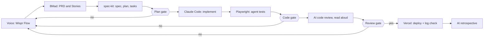

# Goodbye, Manual SDLC?

**Architecting the AI-Driven SDLC: What's Left for Humans?** Conference talk, October 2026.

This repository is both the talk and the demo. The slide deck is a live web app
([ai-driven-sdlc.vercel.app](https://ai-driven-sdlc.vercel.app)), and every feature in it was built
through an AI-driven lifecycle. The requirements were spoken, then turned into specs. AI wrote and
reviewed the code, and AI deployed it and checked the logs. A human approved or rejected the work at
the gates. The code has no hand-written lines. The slide wording and speaker notes belong to the
presenter.

> Say it. See it. Ship it. Humans at the gates, not the keystrokes.

## The lifecycle



Humans review through three channels. They **read** short summaries, **listen** to reviews read
aloud with each word highlighted as it is spoken, and **see** tables and diagrams. Each gate produces
a [Gate Review Pack](templates/gate-review-pack.md) that combines all three.

## The three gates

| Gate | When | How it is enforced |
|---|---|---|
| Plan | Before `/speckit-implement` | spec-kit hook ([`.specify/extensions.yml`](.specify/extensions.yml)) stops the agent and asks |
| Code | After implementation and tests | spec-kit hook |
| Review | After the AI code review | The decision is recorded with a fingerprint of everything that ships. `npm run ship` refuses to deploy if any shipped file has changed since the yes. |

Decisions are recorded in the [gate log](_bmad-output/initiative-ai-driven-sdlc/epic-keynote-deck/gates.jsonl).
The plan and code gates are prompts that the agent follows. The review gate is enforced by
`npm run ship`, not by Vercel. The agent is instructed never to answer a gate itself, and the gate
log makes any decision visible in review.

## Where everything is

| Artifact | Location |
|---|---|
| PRD, decision log, research | [`_bmad-output/.../prd-ai-driven-sdlc/`](_bmad-output/initiative-ai-driven-sdlc/prd-ai-driven-sdlc/prd-ai-driven-sdlc.md) |
| Epic and Stories (BMad) | [`epic-keynote-deck.md`](_bmad-output/initiative-ai-driven-sdlc/epic-keynote-deck/epic-keynote-deck.md), [`tickets.toml`](_bmad-output/initiative-ai-driven-sdlc/epic-keynote-deck/tickets.toml) |
| Specs (spec-kit) | [`specs/`](specs/) |
| Constitution | [`.specify/memory/constitution.md`](.specify/memory/constitution.md) |
| Gate Review Packs | [`epic-keynote-deck/gates/`](_bmad-output/initiative-ai-driven-sdlc/epic-keynote-deck/gates/) and `story-*-gate-review.md` |
| Gate skills | [`.claude/skills/speckit-gate/`](.claude/skills/speckit-gate/SKILL.md) |
| Slides | [`slides.md`](slides.md), [`pages/`](pages/) |

**Spec-kit coverage:** Stories 1 and 7 went through the full `/speckit-*` command pipeline. Stories
2–6 have specs in spec-kit's format, but they were implemented without `/speckit-implement`, so their
gates were not triggered by hooks. The retrospective covers this.

## Run it

Requires Node 22 and npm. Presenting needs macOS for the read-aloud feature.

```sh
npm install && npx playwright install chromium
npm run dev               # http://localhost:3030 — presenter view at /presenter
```

Keys: ← → ↑ ↓ to navigate, **M** to jump to live monitoring and back.

| Command | What it does |
|---|---|
| `npm run verify` | Unit tests, end-to-end tests, build, and the speaker-notes leak check |
| `npm run ship` | `verify`, then the review gate check, then deploy to Vercel |
| `npm run review:speak -- <pack.md> --highlight` | Reads a Gate Review Pack aloud and highlights each word in iTerm or Terminal |
| `npm run gate:record -- --stage <plan\|implement\|review> --story <id> --decision <yes\|no>` | Records a human decision |
| `npm run qr` | Regenerates the QR codes on the links slide |

## Tools

[Claude Code](https://claude.com/claude-code) ·
[GitHub spec-kit](https://github.com/github/spec-kit) ·
[BMad Method](https://github.com/bmad-code-org/BMAD-METHOD) ·
[Wispr Flow](https://wisprflow.ai) · [Slidev](https://sli.dev) ·
[Playwright](https://playwright.dev) · [Vercel](https://vercel.com)

## License

Copyright 2026 400kelvins. Licensed under the [Apache License 2.0](LICENSE).
