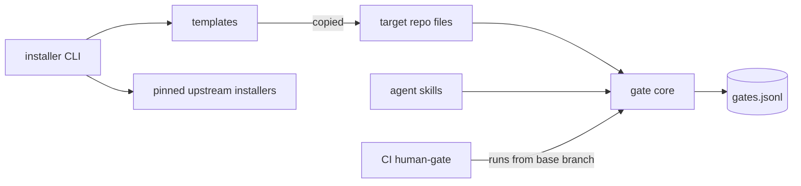
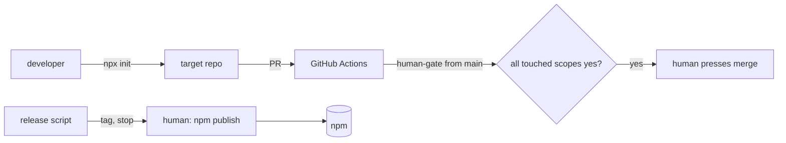

# Architecture Spine — understand-gate

## Design Paradigm

**Copy-in scaffolder.** `npx understand-gate init` copies scripts, skills, workflows, and a constitution
into the target repo. After install the repo owns those files; the package is only needed to install,
update, and uninstall. Gate state is an **append-only ledger** in the repo.

| Layer | Lives in (package source) | Lands in (target repo) |
| --- | --- | --- |
| Installer CLI | `packages/understand-gate/bin/`, `src/install/` | not copied |
| Templates (owned by repo after copy) | `packages/understand-gate/templates/` | `.understand-gate/`, `.github/`, agent skill dirs, `AGENTS.md` |
| Gate core (ledger, fingerprint, check) | `templates/.understand-gate/bin/` | `.understand-gate/bin/` |
| Upstreams | not bundled | installed by pinned BMad Method + spec-kit installers |



Dependency rule: skills and CI call the gate core; the gate core calls nothing but `git`, `gh`, and Node
built-ins. The installer never runs at gate time.

## Inherited Invariants

| Inherited | From parent | Binds here |
| --- | --- | --- |
| Package in this repo under `packages/<name>/`, npm workspaces | PRD memlog | AD-4 path, AD-10 |
| Invoke pinned upstream installers, never bundle (FR-3, NFR-4) | PRD | AD-9 |
| CI `human-gate` is the one enforcement point (NFR-3) | PRD | AD-2, AD-5 |
| No telemetry (NFR-1) | PRD | AD-7 |

## Invariants & Rules

### AD-1 — Copy-in, tracked by a manifest [ADOPTED]

- **Binds:** FR-1, FR-4, NFR-5
- **Prevents:** update or uninstall deleting a file the user edited, or missing a file it installed.
- **Rule:** Every file the installer writes is listed in `.understand-gate/manifest.json` with its path,
  sha256, and package version. Update replaces a file only when its hash still matches the manifest;
  otherwise it shows the diff and asks. Uninstall removes only listed files with matching hashes and
  asks for the rest. No file outside the manifest is ever written or removed.

### AD-2 — The checker runs from the base branch [ADOPTED]

- **Binds:** FR-22, NFR-3
- **Prevents:** a pull request rewriting the gate check so it always passes.
- **Rule:** The `human-gate` CI job checks out the gate core from the base branch (`main`) and runs it
  against the PR head, using `config.json` from the base branch too, so a PR cannot shrink a scope or
  add a reviewer to pass itself. A change to the gate core, its workflow, or the config passes the *old*
  checker first. The
  installer writes `CODEOWNERS` entries for `.github/` and `.understand-gate/`.

### AD-3 — Scopes: one decision per scope, every touched scope must pass [ADOPTED]

- **Binds:** FR-21, FR-22
- **Prevents:** a deck-only yes covering package code, or one story's yes blocking an unrelated folder.
- **Rule:** `.understand-gate/config.json` defines named scopes (include and exclude globs). The default
  install has one scope, `repo`. A fingerprint is computed per scope over files it includes. A scope is touched
  when any file changed between the merge base and the PR head matches its globs. `human-gate`
  passes only when every scope the PR touches has a latest `review` decision of `yes` whose fingerprint
  matches. Docs and gate artifacts are excluded from every scope by default.

### AD-4 — One ledger, append-only [ADOPTED]

- **Binds:** FR-21, FR-27, CM-2
- **Prevents:** two writers with different record shapes, or a rewritten history.
- **Rule:** `.understand-gate/gates.jsonl`, one JSON object per line:
  `{ts, scope, stage, story, decision, fingerprint, proof, attempts, firstTry, confidence, note}`.
  Only the gate core writes it, by appending. The latest line for a (scope, stage) decides. Fields are
  added, never renamed or removed.

### AD-5 — Proof of a human yes [ADOPTED]

- **Binds:** FR-27
- **Prevents:** the agent recording a yes that CI accepts as human.
- **Rule:** `config.json` sets `proof: "comment"` (default) or `"signed"`.
  - `comment`: CI accepts a yes only when a PR comment `/understand-gate yes <scope> <fingerprint>` exists
    from a login in `config.reviewers`.
  - `signed`: CI accepts a yes only when the ledger line was added in a commit signed by a key in
    `config.reviewers`.

  In both modes the ledger line is required too; the proof must name the same fingerprint.
  The docs state that `comment` mode can be spoofed by an agent holding the human's `gh` token.

### AD-6 — Review pack contract [ADOPTED]

- **Binds:** FR-12..FR-18
- **Prevents:** speakers, graders, and skills each parsing a different pack shape.
- **Rule:** A pack is Markdown at `.understand-gate/packs/<story>-<stage>.md` with a `**Decision**:` header
  and these headings in order: `Summary (read aloud)`, `Diagram` (one mermaid block), `Tasks`,
  `Walkthrough`, `Quiz`. Speakers read only `Summary (read aloud)`. The explanation is graded by a
  separate AI session from the one that wrote the code. No is accepted at any step (FR-18).

### AD-7 — Nothing leaves the repo [ADOPTED]

- **Binds:** NFR-1, CM-2
- **Prevents:** a quiet stats or crash upload.
- **Rule:** The package makes no network calls except `git`, `gh` (to the user's own GitHub), and the
  upstream installers. CM-2 statistics are computed locally from the ledger.

### AD-8 — One skill source, copied per agent [ADOPTED]

- **Binds:** FR-2, NFR-3
- **Prevents:** Claude Code and Codex skills drifting apart.
- **Rule:** Skills exist once in `templates/skills/`. The installer copies them to each selected agent's
  path (`.claude/skills/`, `.agents/skills/`). Gate rules live in `AGENTS.md`; `CLAUDE.md` imports it with
  `@AGENTS.md`. No agent hook is relied on for enforcement.

### AD-9 — Upstreams pinned and contract-tested [ADOPTED]

- **Binds:** FR-3, NFR-4
- **Prevents:** a silent upstream path change breaking installs.
- **Rule:** Upstream versions live in one file, `packages/understand-gate/upstreams.json`. A pin is at
  least two weeks old. A bump merges only with contract tests passing against the new version.

### AD-10 — Human publishes; the repo dogfoods [ADOPTED]

- **Binds:** release, SM-3
- **Prevents:** an agent publishing to npm, or two gate implementations drifting.
- **Rule:** `npm run release -w understand-gate` runs tests and contract tests, checks a `package`-scope
  review yes, bumps the version, and tags `understand-gate@x.y.z`, then stops. The human runs
  `npm publish`. No npm token is stored in GitHub. By the end of epic 1 this repo installs
  understand-gate on itself and `scripts/gate.mjs` is removed.

## Consistency Conventions

| Concern | Convention |
| --- | --- |
| CLI | `understand-gate <init\|update\|uninstall\|record\|check\|fingerprint\|stats>`; exit 0 pass, 1 fail, 2 usage |
| Files in target repo | everything under `.understand-gate/` except `.github/`, agent skill dirs, `AGENTS.md` |
| Ids | story = tracker issue number; scope = kebab-case; fingerprint = 16 hex chars of sha256 |
| Dates | ISO 8601 UTC |
| Errors | one-line reason on stderr naming the scope and stage |
| Config | `.understand-gate/config.json` is the only config file |
| Alias | `read-listen-see` is a thin package whose bin calls `understand-gate` |

## Stack

| Name | Version |
| --- | --- |
| Node.js (ESM, zero runtime deps) | ≥ 20.12 |
| Test runner | `node:test` |
| GitHub access | `gh` CLI |
| spec-kit (`specify-cli`) | v1.0.13 |
| BMad Method (`bmad-method`) | 6.12.0 |
| Speech backends | macOS `say`, Windows SAPI, browser Web Speech |

## Structural Seed

```text
packages/understand-gate/
  bin/understand-gate.mjs     # CLI entry
  src/install/                # init, update, uninstall, manifest
  templates/
    .understand-gate/bin/     # gate core: ledger, fingerprint, check, stats, speak
    .github/workflows/        # human-gate, ai-review, pr-visuals
    skills/                   # one source, copied per agent
    AGENTS.md  constitution.md
  upstreams.json
  tests/                      # unit + contract tests
packages/read-listen-see/     # alias
```



## Capability → Architecture Map

| Capability | Lives in | Governed by |
| --- | --- | --- |
| F1 Install / uninstall | `src/install/` | AD-1, AD-8, AD-9 |
| F2 Onboarding, demo story | `templates/skills/` | AD-6 |
| F3 Repo init context | `.understand-gate/context.md` | conventions |
| F4 Tracker | skills via `gh` | AD-7 |
| F5 Spec + gates | skills, spec-kit hooks | AD-4, AD-8 |
| F6 Review experience | gate core `speak`, packs | AD-6 |
| F7 Decisions | gate core `record` | AD-4, AD-5 |
| F8 Enforcement | `.github/workflows/`, gate core `check` | AD-2, AD-3, AD-5 |
| F9 Constitution | `templates/constitution.md` | AD-1 |

## Deferred

| Item | Why it can wait |
| --- | --- |
| BMad V7 migration | V7 is alpha (ETA 2026-10-16); revisit when stable and contract tests pass |
| Trackers after GitHub (OQ-2) | PRD defers to first monthly review |
| Linux speech backend | espeak-ng word events unverified; browser fallback covers it |
| Splitting the package into its own repo | when outside contributors arrive |
| Opt-in telemetry | NFR-1: not in v1 |
| Team roles | PRD non-goal |
