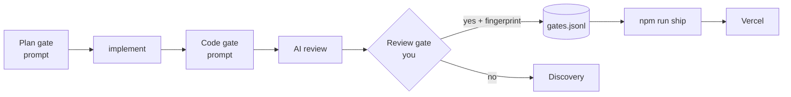

# Gate Review Pack — Review gate: gate slides and gate fingerprint (Story 6)

**Gate**: review → ship | **Date**: 2026-10-12 | **Fingerprint**: `2fa4ed76bd8449f9` | **Decision**: yes (2026-10-12, presenter)

## Summary (read aloud)

This is your first real review gate. The slides now show three human gates: plan, code, and review. The AI review caught that the slides promised more than the tooling does, so the wording is now honest: the plan and code gates are prompts, and only the review gate is enforced, by the ship command. It also caught a real gap: slide files were not part of the fingerprint, so slide text could change after your yes. That is fixed. All tests pass. A yes here lets npm run ship deploy exactly this version.

## What changed

| File | Change |
|---|---|
| `pages/talk.md` | New SDLC + pipeline flows show Plan / Code / Review gates; tools table names the gates; new slide **"Gates with teeth"**; Monday step 3 = three gates |
| `scripts/gate.mjs` | Fingerprint covers everything that ships: code, config, `slides.md`, `pages/*.md`; excludes only planning docs |
| `tests/unit/gate.test.mjs` | Test for what counts as shipped |

## Verify

| Check | Result |
|---|---|
| Unit (node:test) | 18 pass |
| End-to-end (Playwright) | 14 pass |
| Build | ✅ |
| Notes leak | ✅ none (47 note lines checked) |
| Visual | 5 slides screenshotted; 1 overflow fixed |

## Diagram

## AI code review — findings and actions

| Severity | Finding | Action |
|---|---|---|
| 🔴 | "Change one line and shipping stops" was false for slides (`*.md` excluded) | **Fixed in code**: slides now in fingerprint + test |
| 🔴 | "The AI is not allowed to answer for me" sounded technically enforced | **Fixed**: notes say instructed, not prevented; ledger makes it visible |
| 🔴 | "Gates you can't skip": only review gate is enforced | **Fixed**: retitled "Gates with teeth"; plan/code marked "spec-kit prompts" |
| 🔴 | "Only way to Vercel" — `npx vercel` bypasses | **Fixed**: "`npm run ship` needs a review yes"; notes name the bypass |
| 🟡 | Ship output shown as real | **Fixed**: labelled "example output" |
| 🟡 | "Three gates" vs other human touchpoints | **Fixed**: "three gates in the build" |

## Process note

Implemented without `/speckit-implement` (see chat): the plan and code gates did not fire for this change. This review gate is run by hand via `/speckit-gate-review`.
