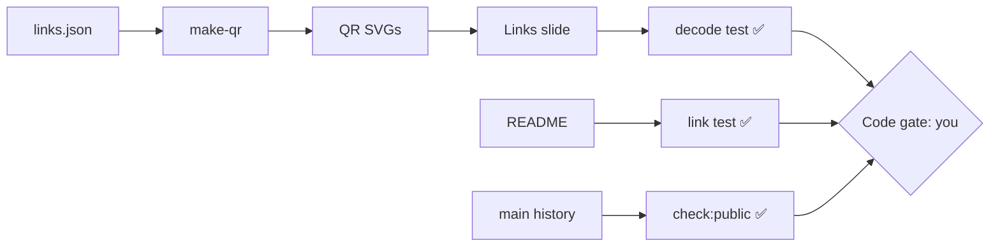

# Gate Review Pack — Code gate: Story 7, publish the blueprint and links slide

**Gate**: implement → AI review | **Date**: 2026-10-12 | **Fingerprint**: `4ac95b040ce3109e` | **Decision**: yes (2026-10-12, presenter)

## Summary (read aloud)

Story seven is implemented locally, and nothing has been published yet. The try it yourself slide shows two QR codes. A test takes a picture of each code on the rendered slide, decodes it, and confirms it opens the right address, with the network off. The readme explains the blueprint and links every artifact, and a test checks that every link works. A new check scans the history for personal email and secrets. It caught a fake key inside one of our own tests, which is fixed. All forty tests pass. Please scan both codes with your phone. The repository code will show not found until we publish.

## What was done

| Task | Result | Evidence |
|---|---|---|
| T001–T002 | Pinned `qrcode`, `jsqr`, `pngjs`; one source of URLs | `package.json`, `scripts/links.json` |
| T003–T007 | QR SVGs generated and committed; Links slide with notes | `public/qr/*.svg`, `pages/links.md` |
| T004 | **QR codes decoded from the rendered slide**, offline, size ≥ ¼ slide | `tests/links.spec.ts` |
| T008–T010 | README (blueprint, gates, artifact map, commands); Apache-2.0 (canonical text, sha256 `c71d239d…`); README links all resolve | `README.md`, `LICENSE` |
| T011–T012 | `check:public`: main history clean; backup branch correctly fails | `scripts/check-public.mjs` |
| Not done yet | T013 review gate, T014 publish, T015 ship + deploy log pack | after your gates |

## Verify

| Check | Result |
|---|---|
| Unit (node:test) | 24 pass |
| End-to-end (Playwright) | 16 pass (incl. QR decode) |
| Build + notes leak | ✅ (48 note lines checked) |
| `check:public` on main | ✅ noreply emails only, no token patterns |
| Visual | Links slide screenshot: clean, codes large |

## Estimate vs actual

| Measure | Estimate | Actual |
|---|---|---|
| Time | 1 h | ~6 min agent time to this gate (20:41–20:47 UTC) |
| Story points | 3 | 3 |
| Tokens / $ | 250k / $2.50 | at Story 9 |
| Test type | — | Playwright e2e with real QR decoding; node:test unit |

## Diagram

## Found during implementation

| Finding | Action |
|---|---|
| `check:public` flagged a literal private-key header inside its own unit test | **Fixed**: string built at runtime; commit amended before any push |

## Your check at this gate

- Scan both QR codes on the screenshot with your phone. The deck code opens the live site; the repo code opens GitHub **404 until published**.
