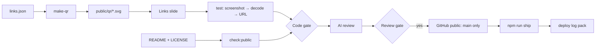

# Gate Review Pack — Plan gate: Story 7, publish the blueprint and links slide

**Gate**: plan → implement | **Date**: 2026-10-12 | **Decision**: yes (2026-10-12, presenter) — license Apache-2.0

## Summary (read aloud)

This is your plan gate for story seven, and the first gate that spec-kit stopped at on its own. The plan adds a "Try It Yourself" slide with two QR codes, one for the live deck and one for the public repository, built into the deck so they work offline. A test will scan both codes from the rendered slide to prove they open the right address. It also adds a readme that explains the blueprint, and an MIT license. Publishing to GitHub is the very last step, only after your review gate, and only the main branch is pushed. Estimate: one hour, three story points.

## Spec in one line

Attendees scan a code to open the live deck or the public blueprint repo; the repo shows the whole lifecycle; nothing private is published. (`specs/007-publish-repo-links/spec.md`)

## Tasks

| ID | Task | File |
|---|---|---|
| T001 | Pin `qrcode`, `jsqr`, `pngjs`; add `qr` script | `package.json` |
| T002 | One source of link URLs | `scripts/links.json` |
| T003–T004 | Tests: generator unit test; **decode both QR codes from the rendered slide** | `tests/unit/make-qr.test.mjs`, `tests/links.spec.ts` |
| T005–T007 | Generate QR SVGs; build Links slide with notes | `scripts/make-qr.mjs`, `public/qr/*.svg`, `pages/links.md` |
| T008–T010 | README (blueprint, gates, artifact map, commands); MIT LICENSE; test README links resolve | `README.md`, `LICENSE` |
| T011–T012 | `check:public`: scan main history for personal email and tokens; verify | `scripts/check-public.mjs` |
| T013 | Code gate → AI review → **review gate** | — |
| T014 | **After review yes**: create public repo, push `main` only | GitHub |
| T015 | Ship; deploy log check → deploy Gate Review Pack | Vercel |

## Estimate

| Measure | Estimate |
|---|---|
| Time | 1 h |
| Story points | 3 |
| Tokens | ~250k |
| Dollars | ~$2.50 (API-equivalent; covered by subscription) |
| Test type | Playwright e2e with real QR decoding; node:test unit |

## Diagram

## Decisions for you

- **License: Apache-2.0** (presenter choice at this gate).
- **Publish order**: the irreversible push is last, after the review gate.

## Risks

- QR too small from the back of the room → codes sized ≥ a quarter of the slide height; you scan them at the code gate.
- Repo name was free when checked; if taken by publish time, publishing stops and reports.
