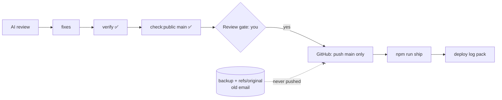

# Gate Review Pack — Review gate: Story 7, publish the blueprint and links slide

**Gate**: review → publish + ship | **Date**: 2026-10-12 | **Fingerprint**: `52327a67d4b4249b` | **Decision**: yes (2026-10-12, presenter) — decision log published; Story 11 approved after publish

## Summary (read aloud)

The AI review of story seven found one critical problem. Your old Gmail address still lived in two local git references, the backup branch and a leftover from the rewrite. Pushing only main keeps them private, but the safety scan now checks every reference and commit message, and it flags them. Six medium issues are fixed, mostly making the scan wider and the readme more honest about which gates are enforced. All forty six tests pass. Two decisions are yours: whether the internal decision log is published, and when to delete the backup. A yes here lets me publish main and ship.

## Verify

| Check | Result |
|---|---|
| Unit (node:test) | 30 pass (incl. 4 integration tests on temp repos) |
| End-to-end (Playwright) | 16 pass (incl. QR decode) |
| Build + notes leak | ✅ |
| `check:public main` | ✅ allowed emails only; no token patterns in changes or messages |
| `check:public --all` | ❌ by design: backup branch + `refs/original` carry the old email — **never pushed** |

## AI code review — findings and actions

| Severity | Finding | Action |
|---|---|---|
| 🔴 | Local backup branch and `refs/original/refs/heads/main` still carry personal email; scan only walked `main` | **Mitigated**: publish pushes `main` only; scan gained `--all` and flags them. **Deletion is your call** (below) |
| 🟡 | Scan skipped commit messages and Co-Authored-By trailers | **Fixed**: messages + trailers scanned; trailers checked against allow-list |
| 🟡 | Token patterns: guessed Vercel format, missing Google / npm / generic | **Fixed**: added `AIza…`, `npm_…`, generic `secret/token/password = "…"`; each tested |
| 🟡 | No test ran the real git scan | **Fixed**: integration tests build temp repos with a bad email, a secret in a message, and a bad branch |
| 🟡 | README overstated plan/code gate enforcement | **Fixed**: "declared as required hooks; the agent is instructed to wait" + links to the gate skills |
| ❓ | README "Stories 1 and 7 full pipeline" vs no Story 1 gate entries | **Fixed**: Story 1 ran all commands before gates existed; Story 7 is the first with all three gates logged |
| 🟡 | README link test used a magic floor; untracked targets could pass | **Fixed**: every link must be tracked in git; core artifacts required |
| 🟡 | `.memlog.md` (internal decision log) would be public | **Your decision** (below) |

## Diagram

## Decisions for you

1. **Decision log** (`.memlog.md`, 57 lines: my one-line notes of your decisions, e.g. "Honest part acknowledged; addressed in a later slide"). Publish it as part of the blueprint's audit trail, or keep it out of the public repo?
2. **Backup refs** with the old email: delete after the publish is verified (you run one command; the safety hook won't let me), or keep locally.
