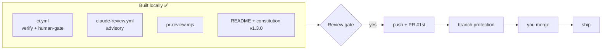

# Gate Review Pack — Implement gate: Story 11, PR workflow

**Gate**: implement → review | **Date**: 2026-10-14 | **Decision**: yes (2026-10-14, presenter)

## Summary (read aloud)

The local part of story eleven is built and every test passes. There are two new GitHub workflows. The first runs the full test suite and your review gate on every pull request. The second asks Claude to review the pull request and post one comment. A new command pulls that comment into your review pack. The readme and the constitution now describe the pull request flow. Nothing has been pushed yet. The live steps wait until after the review gate, and they need your extra GitHub permission and your Claude token.

## Tasks

| Done | Task | Result |
|---|---|---|
| ✅ T001 | `pr:review` script | `package.json` |
| ✅ T003–T004 | CI workflow: `verify`, `human-gate` (checks out the PR head) | `.github/workflows/ci.yml` |
| ✅ T005–T008 | AI review workflow (fork guard, skips when the secret is missing, advisory) and `pr-review.mjs` | `.github/workflows/claude-review.yml`, `scripts/pr-review.mjs` |
| ✅ T009 | Review gate includes the PR's AI review | `.claude/skills/speckit-gate/SKILL.md` |
| ✅ T010 | README: "Pull requests" section | `README.md` |
| ✅ T011 | Constitution v1.3.0 via `/speckit-constitution` | `.specify/memory/constitution.md` |
| ✅ T012 | Verify and public scan | below |
| ⏳ T002, T013 | 🧑 You: `workflow` scope; Claude token secret | — |
| ⏳ T014–T018 | Push, PR, protection, AI review, merge, ship | after the review gate |

## Verify

| Check | Result |
|---|---|
| Unit (node:test) | **44 pass** (+14: 5 review parser, 9 workflow shape) |
| End-to-end (Playwright) | 16 pass |
| Build and notes leak | ✅ |
| `check:public` on `main` and `008-pr-workflow` | ✅ allowed emails only, no token patterns |
| `npm run pr:review` (no PR yet) | `_No pull request for this branch._`, exit 0 |

## Diff since the plan gate

`11 files changed, 349 insertions(+), 8 deletions(-)` (workflows, script, 2 test files, README, skill, constitution, package.json, tasks).

## Caught along the way

| What | Action |
|---|---|
| The README link test failed: it linked the workflow files before they were tracked | Working as designed; committed the files and the test passed |
| The review workflow first requested `id-token: write` | Removed; not needed with `github_token` (least privilege) |

## Estimate vs actual (so far)

| Measure | Estimate | Actual |
|---|---|---|
| Time (local part) | about 1 h | about 25 min |
| Story points | 5 | 5 |

## Diagram

