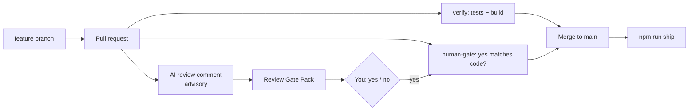

# Gate Review Pack — Plan gate: Story 11, PR workflow

**Gate**: plan → implement | **Date**: 2026-10-14 | **Issue**: [#1](https://github.com/400kelvins/ai-driven-sdlc/issues/1) | **Decision**: yes (2026-10-14, presenter)

## Summary (read aloud)

This is your plan gate for story eleven, the pull request workflow. From now on, every change reaches main through a pull request. GitHub will run the full test suite and your review gate as two required checks, so nothing merges until the tests pass and your yes covers the exact code. An AI reviewer comments on every pull request. It never blocks the merge, and its findings go into your review pack. This story will itself be the repository's first pull request, closing issue one. You will need to do two small things: grant one extra GitHub permission, and add your Claude token as a repository secret. Estimate: one and a half hours, five story points.

## Spec in one line

A change reaches `main` only through a PR with green tests and a review-gate yes that matches its exact code. Every PR gets an AI review that also appears in the gate pack. (`specs/008-pr-workflow/spec.md`)

## Tasks

| ID | Task | File |
|---|---|---|
| T001 | `pr:review` script | `package.json` |
| T002 | 🧑 **You**: `gh auth refresh -h github.com -s workflow` | — |
| T003–T004 | Test and build the CI workflow: jobs `verify` and `human-gate` (fingerprint at the PR head) | `.github/workflows/ci.yml`, `tests/unit/workflows.test.mjs` |
| T005–T008 | Test and build the AI review workflow (advisory) and `pr-review.mjs` | `.github/workflows/claude-review.yml`, `scripts/pr-review.mjs` |
| T009 | Review gate pulls in the PR's AI review | `.claude/skills/speckit-gate/SKILL.md` |
| T010–T012 | README "Pull requests"; constitution v1.3.0; verify and public scan | `README.md`, constitution |
| T013 | 🧑 **You**: `claude setup-token` → `gh secret set CLAUDE_CODE_OAUTH_TOKEN` | GitHub secret |
| T014–T017 | Push, open the PR (`Closes #1`), turn on branch protection, AI review, review gate; you merge | GitHub |
| T018 | `npm run ship` from `main` and the deploy log pack | Vercel |

## Key choices

| Choice | Why |
|---|---|
| Human gate = a required **CI check**, not a PR approval | GitHub forbids approving your own PR |
| AI review is **advisory** | An outage or a missing token must not block your decision |
| Protection applies to **admins too**, with no force pushes | You can't bypass it by accident; turning it off is a deliberate change in Settings |
| Actions pinned: checkout v7.0.1, setup-node v7.0.0, claude-code-action v1.0.237 | Each is at least 2 weeks old |
| Merge does **not** deploy | Vercel isn't linked to git; `npm run ship` stays the only deploy path |

## Estimate

| Measure | Estimate |
|---|---|
| Time | 1.5 h (including CI runs) |
| Story points | 5 |
| Tokens | ~400k |
| Dollars | ~$4 at API prices (covered by the subscription), plus GitHub Actions minutes (free for public repos) |
| Test type | node:test unit (workflow shape, review parser); live end-to-end on this PR |

## Diagram

## Risks

| Risk | Mitigation |
|---|---|
| Subscription token billing for CI is unverified | Noted for the retrospective; the review is advisory |
| Today is the talk day: protection blocks quick fixes | Every fix goes through a PR (CI about 5 min). Emergency: you relax protection in Settings |
| `content:` edits now need a PR too | Constitution v1.3.0 states this |
