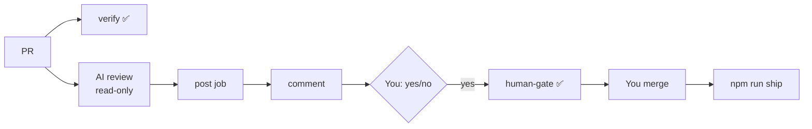

# Review gate: Story 11, PR workflow

**PR**: [#2](https://github.com/400kelvins/ai-driven-sdlc/pull/2) · **Issue**: #1 · **Date**: 2026-10-14 · **Decision**: no, then yes after re-explanation (2026-10-14, presenter)

## Summary (read aloud)

Story eleven is ready for your review. Every change now reaches main through a pull request with two required checks: the tests, and your review gate. The AI reviewer comments on every pull request. It cannot merge, and it cannot block. Two rounds of AI review found eight real problems, and all are fixed. A yes turns the gate check green, and then you press merge.

## What you approve

- **Required checks**: `verify` (tests and build) and `human-gate` (your yes matches this exact code)
- **Protection on `main`**: admins included, no force pushes, branch must be up to date
- **AI review**: advisory only, runs in a **read-only** job; a separate job with no model posts the comment
- **Merge does not deploy**: `npm run ship` on `main` still does that

## AI review: what it found and what happened

| Round | Found | Status |
|---|---|---|
| Local review | 3 🔴, 9 🟡 | ✅ fixed; 1 documented (solo-repo limit) |
| PR review 1 | 2 🟡, 3 🔵 | ✅ fixed |
| PR review 2 | 1 🟡 (planted tool on PATH) | ✅ fixed: read-only review job plus a separate post job |
| PR review 3 | 1 🟡 (checks matched by name only) | ✅ fixed: pinned to the GitHub Actions app |
| PR review 3 | 3 🔵 | ⏭ deferred: fork skip comment, a test for the record refusal, token in the read-only job |

## Live issues fixed along the way

- Subscription token rejected → **API key and workspace ID** (your choice)
- An unquoted `:` broke the workflow file → **YAML validity test added**
- The token guard flagged a quoted pattern → **matches real token shapes only**

## Tests

- 51 unit · 16 e2e · build · notes leak · public scan ✅
- CI on the PR: `verify` ✅ · `review` ✅ · `post` ✅ · `human-gate` ⏳ your yes

## Honest limit

- Solo repo: anyone with your login could add a "yes" to the gate log
- Controls: agents never merge · the gate log is public · **you** press merge

## Diagram

