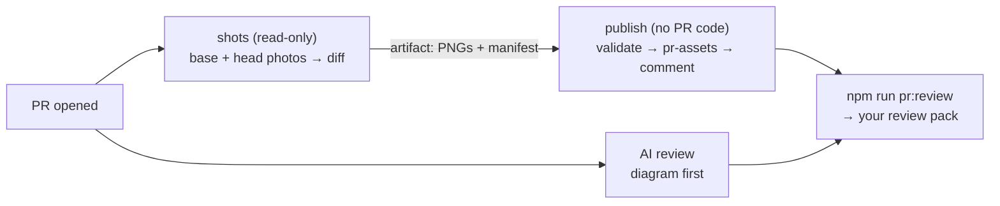

# Gate Review Pack — Implement gate: Story 12, visual PRs

**Gate**: implement → review | **Date**: 2026-10-14 | **Issue**: [#3](https://github.com/400kelvins/ai-driven-sdlc/issues/3) | **Decision**: yes (2026-10-14, presenter; quiz passed after re-explanation)

## Summary (read aloud)

Story twelve is built and every test passes. Two new scripts photograph every slide and keep only the ones that changed. In a local test, two runs of the same deck found zero changes, and a one-word edit found exactly slide three. A new workflow posts those before and after pictures on the pull request, and the AI review now starts with a diagram. While checking, the public scan found your work email in the merge commit GitHub made for pull request two. You chose to leave that history as it is.

## Proof it works (local)

| Run | Result |
|---|---|
| Same deck photographed twice | `0 changed` (21 slides, ~25 s each) |
| Slide 3 wording edited, then reverted | `1 changed` → `003-before.png`, `003-after.png` |
| Comment rendering: changed / none / 12 changed / base missing | ✅ all four shapes as in the contract |
| Bad manifest (an extra field) | rejected ✅ |

## Tasks

| Done | Planned |
|---|---|
| T001–T013 ✅ | 13 of 13 before the live phase |

## Tests

- **68 unit** (was 51): slide diff ×7, workflow shape ×7 new, PR review ×3 new
- **16 e2e** · build · notes leak ✅
- Public scan on this branch ✅ (allowed now: GitHub's own web-merge and bot addresses)

## What changed (`git diff --stat` since main, shipped code)

| File | Lines |
|---|---|
| `.github/workflows/pr-visuals.yml` (new) | +201 |
| `scripts/slide-shots.mjs`, `slide-diff.mjs` (new) | +94 |
| `scripts/pr-review.mjs` | +24 / −8 |
| `claude-review.yml` (diagram first) | +4 |
| tests, README, package.json | rest |

## Diagram

## Estimate vs actual

| Measure | Estimate | Actual |
|---|---|---|
| Time | 1.5 h | ~25 min of build time, not counting the live phase |
| Story points | 5 | 5 |

## Not done yet

- Live phase (T014–T017): PR, throwaway one-slide PR, review gate, your merge, ship.
