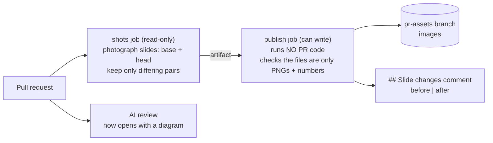

# Gate Review Pack — Plan gate: Story 12, visual PRs

**Gate**: plan → implement | **Date**: 2026-10-14 | **Issue**: [#3](https://github.com/400kelvins/ai-driven-sdlc/issues/3) | **Decision**: yes (2026-10-14, presenter; quiz passed on second try)

## Summary (read aloud)

This is your plan gate for story twelve, visual pull requests. Every pull request will get a comment with before and after pictures of each slide it changed, and nothing else. The AI review will open with a diagram of the change. The pictures live on a separate branch, so main never fills up with images. The job that runs the pull request's code can only read; a second job, which never runs that code, is the only one that can write. Estimate: one and a half hours, five story points.

## In one picture

Think of it like a **spot-the-difference puzzle**: photograph every slide before, photograph every slide after, show only the pairs that differ.

## What changes

- **New:** `pr-visuals.yml` with the `shots` and `publish` jobs
- **New:** `slide-shots.mjs` photographs every slide; `slide-diff.mjs` keeps the ones that changed
- **Changed:** the AI review prompt requires a diagram first
- **Changed:** `npm run pr:review` adds the slide comment to your review pack

## Tasks

| ID | Task | File |
|---|---|---|
| T001 | `shots` npm script | `package.json` |
| T002–T005 | Diff tests and script, screenshot script, local check (0 changed → 1 changed) | `scripts/slide-*.mjs` |
| T006–T007 | Workflow tests, then the workflow (read-only shots, separate publish) | `.github/workflows/pr-visuals.yml` |
| T008–T009 | AI review opens with a Mermaid diagram | `claude-review.yml` |
| T010–T011 | Gate pack shows the slide comment | `scripts/pr-review.mjs` |
| T012–T013 | README; verify and public scan | `README.md` |
| T014–T017 | PR `Closes #3`; throwaway PR proves one-slide change; review gate; **you merge**; ship | GitHub |

## Key choices

| Choice | Why |
|---|---|
| Our own screenshot script, not `slidev export` | Export needs a new dependency; ours reuses Playwright. Tested: 21 slides, ~25 s, **identical bytes on two runs** |
| Byte compare, not a pixel-diff tool | Deterministic on one machine; no new dependency |
| `pr-assets` branch | Your choice: inline images, `main` stays clean |
| The comment is built only from numbers | PR files cannot inject text into the comment |
| Advisory, not required | A broken screenshot run never blocks your merge |

## Estimate

| Measure | Estimate |
|---|---|
| Time | 1.5 h (including CI runs) |
| Story points | 5 |
| Tokens | ~400k |
| Test type | node:test unit (diff, workflow shape, parser); local screenshot run; live on this PR plus a throwaway PR |

## Risks

| Risk | Mitigation |
|---|---|
| Inserting a slide shifts every later number → many "changed" | Cap of 10 pairs + "+N more"; a shift is a real change |
| CI fonts differ from the Mac | Base and head both render on the same runner, so the comparison stays fair |
| Images pile up on `pr-assets` | Accepted; cleanup is a later Story |
