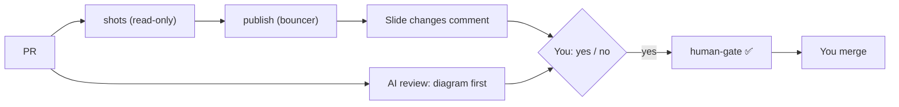

# Gate Review Pack — Review gate: Story 12, visual PRs

**PR**: [#5](https://github.com/400kelvins/ai-driven-sdlc/pull/5) · **Issue**: #3 · **Date**: 2026-10-14 · **Decision**: yes (2026-10-14, presenter; quiz passed first try)

## Summary (read aloud)

Story twelve is ready for your review. It works live: a test pull request that changed one word showed exactly slide three, one of twenty-one, with before and after pictures, and this pull request correctly says no slide changed. Two AI reviews found one critical problem and thirteen smaller ones. All of them are fixed, and the safety checks are now tested by running them against eleven fake attacks. Main has no screenshot files. A yes turns your gate check green, and then you press merge.

## Live proof

| PR | Slide comment |
|---|---|
| #6 (one word on slide 3, closed unmerged) | **1 of 21 slides changed**: slide 3 before and after, images served from `pr-assets` (HTTP 200) |
| #5 (this PR, no slide edits) | **No slide changed** |
| `main` | 0 screenshot files |

## AI review: what it found and what happened

| Round | Found | Status |
|---|---|---|
| Local reviewer | 1 🔴 (an empty commit on a re-run reported a false failure), 8 🟡, 1 🔵 | ✅ fixed: 🔴 and 7 🟡 · ⏭ 1 🟡 deferred (byte compare could be thrown off by render jitter: CI ran 21/21 identical twice) · ⏭ 🔵 fork test structure |
| PR review 1 | 1 🟡 (cancelled runs could post), 5 🔵 | ✅ fixed: 4 · ⏭ 1 deferred (an e2e test for the screenshot script, which CI already runs on every PR) |
| PR review 2 | 1 🔵 (`..x` hidden files) | ✅ fixed + test |

## What is now guaranteed (tested)

- The writing job **never runs PR code** and accepts only `NNN-before/after.png` files that:
  - are real PNG images, at most 2 MB each, with at most 40 files and 50 MB in total
  - **exactly match** the manifest
- **Rejected** (run, not just pattern-matched):
  - `evil.sh`
  - hidden files
  - symlinks
  - fake PNGs
  - extra manifest keys
  - text where a number belongs
  - oversize files
- **Advisory:** neither comment can block a merge. Only `verify` and `human-gate` can.

## Tests

- **70 unit** · **16 e2e** · build · notes leak ✅
- CI on PR #5: `verify` ✅ · `review` ✅ · `shots` ✅ · `publish` ✅ · `human-gate` ⏳ your yes

## Diagram

## Estimate vs actual

| Measure | Estimate | Actual |
|---|---|---|
| Time | 1.5 h | about 1 h 10 min including two review rounds and CI |
| Story points | 5 | 5 |
