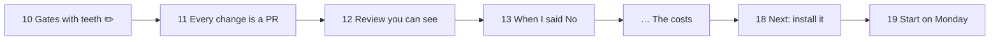

# Gate Review Pack — Review gate: Story 13, slides show the progress

**PR**: [#7](https://github.com/400kelvins/ai-driven-sdlc/pull/7) · **Issue**: #4 · **Date**: 2026-10-14 · **Decision**: yes (2026-10-14, presenter; quiz passed first try)

## Summary (read aloud)

Story thirteen is ready for your review. The AI reviewer checked every fact on the new slides against the repository and found them correct. It found three small problems: missing image descriptions, and tests that checked notes but not the visible text. All three are fixed. The slide changes comment showed sixteen changed slides, because three new slides moved every later one. A yes turns your gate check green, and then you press merge.

## AI review on the PR

| Finding | Status |
|---|---|
| 🔵 Test checks only the notes of "Gates with teeth", not the visible text | ✅ fixed: asserts "enforced at ship + on GitHub" on the slide |
| 🔵 "When I said No" and "Next" only position-checked | ✅ fixed: each slide's key line asserted |
| 🔵 No alt text on the before/after images | ✅ fixed: `alt="Slide 3 before/after"` |
| Facts: PR #6 "1 of 21", Story 11 review "no" in the gate log | ✅ verified by the reviewer |

No critical or medium findings. The PR's AI review was the reviewer for this slides-only Story.

## Slide changes comment

- **16 of 25 slides changed:** slides 10–13 are new or edited, slide 18 is new, and the rest moved down by the insertions. That is the expected behaviour.

## Tests

- **70 unit** · **20 e2e** (+4 for this Story) · build · notes leak ✅
- Talk time ~11.5 min including the demo

## Diagram

