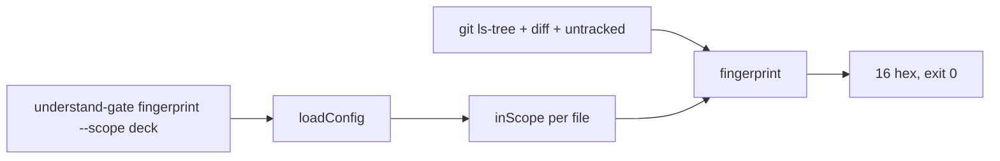

# Gate Review Pack — Implement gate: Story 2.1, package workspace and per-scope fingerprints

**Spec**: `specs/011-package-scopes/` · **Issue**: #10 · **Date**: 2026-10-15 · **Decision**: yes (2026-10-15, presenter; quiz passed on the second try after a live demo)

## Summary (read aloud)

Story two point one is built. The understand-gate package now lives in its own folder, with a command that prints the fingerprint of one scope. This repository has two scopes, the deck and the package. All eleven tasks are done and every test passes, including sixteen new ones. I also checked all six hundred and eighty two tracked files: the new deck scope covers exactly the same files as the old gate rule, so nothing changes for the deck.

## Tasks

| Planned | Done | Skipped |
|---|---|---|
| 11 | 11 | 0 |

## Verify

| Check | Result |
|---|---|
| Unit | ✅ 86 (70 existing + 16 new) |
| E2E | ✅ 20 |
| Build | ✅ |
| Notes leak | ✅ |
| Deck scope vs old `isCode` rule | ✅ 0 differences on 682 tracked files |
| Old `gate:check` | unchanged; fails as before because code changed since Story 13's yes |

## Diff since the plan gate

```text
 .understand-gate/config.json                    | scopes deck + package
 package.json, package-lock.json                 | workspaces, test:unit runs package tests
 packages/understand-gate/bin/understand-gate.mjs| CLI
 packages/understand-gate/src/scopes.mjs         | pattern matcher, config loader
 packages/understand-gate/src/fingerprint.mjs    | per-scope fingerprint
 packages/understand-gate/tests/ (4 files)       | 16 tests on throwaway git repos
 packages/understand-gate/README.md, package.json
 13 files changed, 434 insertions
```

## Diagram



## Estimate vs actual

| Measure | Estimate | Actual |
|---|---|---|
| Time | 1 h | ~30 min |
| Story points | 3 | 3 |

## Quiz

Live in this repo: `npx understand-gate fingerprint --scope package` printed `b98f9276aa9ae733`. If you now edit only `pages/talk.md` and run it again, what does it print?
