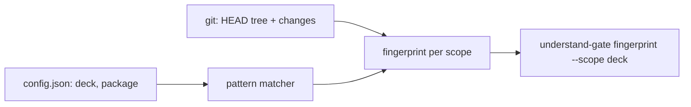

# Gate Review Pack — Plan gate: Story 2.1, package workspace and per-scope fingerprints

**Spec**: `specs/011-package-scopes/` · **Issue**: #10 · **Date**: 2026-10-15 · **Decision**: yes (2026-10-15, presenter; quiz passed on the second try)

## Summary (read aloud)

Story two point one starts the understand-gate package inside this repository. The package gets its own folder and its own command. A new config file splits the repository into two areas, the deck and the package. Each area gets its own fingerprint, so a slide change will not touch the package fingerprint, and a package change will not touch the deck fingerprint. Planning documents touch neither. The old gate keeps working exactly as before until story two point six.

## Goal and stories

| Story | What you get |
|---|---|
| US1 (P1) | `deck` and `package` scopes, each with its own fingerprint |
| US2 (P1) | `understand-gate fingerprint --scope <s>` command; package tests run in `npm run verify` |

## Tasks

| Id | Task | File |
|---|---|---|
| T001 | Workspace + package manifest | `package.json`, `packages/understand-gate/package.json` |
| T002 | Scope config | `.understand-gate/config.json` |
| T003–T004 | Pattern matcher (tests first) | `src/scopes.mjs` |
| T005–T006 | Per-scope fingerprint (tests first) | `src/fingerprint.mjs` |
| T007–T008 | CLI (tests first) | `bin/understand-gate.mjs` |
| T009 | Package tests in `test:unit`, lockfile | `package.json` |
| T010 | README | `packages/understand-gate/README.md` |
| T011 | Verify; old gate unchanged | — |

## Estimate

| Hours | Points | Tokens | Dollars |
|---|---|---|---|
| 1 | 3 | ~400k | ~$6 |

## Diagram

## Risks

- Deck rule must equal today's rule, or the new deck fingerprint covers the wrong files: a test checks sample paths against it.
- Adding workspaces changes `package-lock.json`; CI `npm ci` must still pass.
