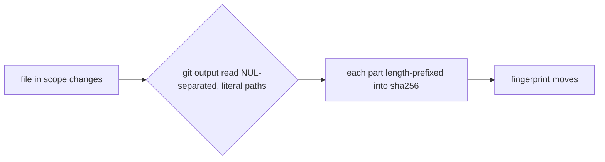

# Gate Review Pack — Review gate: Story 2.1, package workspace and per-scope fingerprints

**PR**: [#11](https://github.com/400kelvins/ai-driven-sdlc/pull/11) · **Issue**: #10 · **Date**: 2026-10-15 · **Decision**: yes (2026-10-15, presenter reviewed the PR; quiz passed on the second try)

## Summary (read aloud)

Story two point one is ready for your review. A local AI reviewer found four serious holes: in each one, a file could change without its fingerprint changing. Renaming a slide away, odd characters in file names, square brackets in names, and swapped bytes between a file name and its content. All four are fixed and each has a test. The AI review on GitHub was skipped because of credit, so you are the reviewer for the pull request. A yes turns your gate check green, and then you press merge.

## AI review (local reviewer; the PR's AI review was skipped for credit)

| Finding | Status |
|---|---|
| 🔴 Staged rename out of a scope did not move it | ✅ fixed: `--no-renames`; test |
| 🔴 Paths with tab, newline, quote, backslash were quoted by git and fell into the wrong scope | ✅ fixed: NUL-separated git output, `s` regex flag; 5 tests |
| 🔴 Names with `[ ] * ?` were read as globs, so their edits were missed | ✅ fixed: `--literal-pathspecs`; test |
| 🔴 Path and content bytes not framed: `x`+`yz` hashed like `xy`+`z` | ✅ fixed: length-prefixed parts; test |
| 🟡 Symlinks hashed by target; exec bit ignored | ✅ fixed: link text + mode; 2 tests |
| 🟡 Typo pattern gives an empty scope that never moves | ✅ fixed: bad forms rejected, empty scope is an error; 2 tests |
| 🟡 Run from a subfolder failed; git's reason was hidden | ✅ fixed: repo root; git's stderr line; 2 tests |
| 🟡 Nested slides `pages/x/y.md` were in no scope | ✅ fixed: `!pages/**/*.md` |
| 🟡 Tests used a hand copy of the config | ✅ fixed: a test loads the real config |
| 🟡 Large repos hit the 1 MB output buffer; user diff config could change output | ✅ fixed: 1 GB buffer, pinned diff flags |
| 🟡 Submodule contents not hashed | ✅ now an error; support deferred |
| 🟡 `core.fileMode=false` hides tracked mode changes | Deferred: same in CI; revisit in 2.7 sweep |
| 🔴 Same rename/quoting/glob/framing bugs in old `scripts/gate.mjs` | Deferred: removed in Story 2.6 |
| ❓ Gitignored files in a scope are not hashed | Kept: CI cannot see them either |

## Tests

- **102 unit** (+32 for this Story) · **20 e2e** · build · notes leak ✅

## Diagram

## Quiz

You `git mv slides.md notes.md` and don't commit. Before the fix, what happened to the deck fingerprint?
