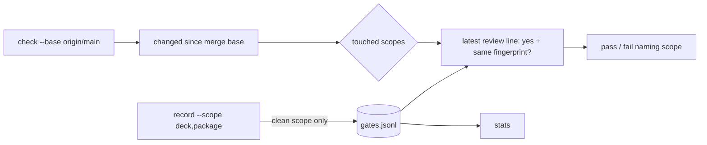

# Gate Review Pack — Implement gate: Story 2.2, ledger v2 and check every touched scope

**Spec**: `specs/012-ledger-v2/` · **Issue**: #12 · **Date**: 2026-10-15 · **Decision**: yes (2026-10-15, presenter; quiz passed first try)

## Summary (read aloud)

Story two point two is built. understand-gate can now record your decisions, one line per area, check every area a branch touched, and show quiz stats. Tried live on this branch: the branch only changed the package, so the check failed and named only the package. All ten tasks are done and every test passes, including twenty one new ones. One small change from the plan: the touched-files logic lives in the git module instead of a separate file.

## Tasks

| Planned | Done | Skipped |
|---|---|---|
| 10 | 10 | 0 |

## Verify

| Check | Result |
|---|---|
| Unit | ✅ 123 (102 existing + 21 new) |
| E2E | ✅ 20 |
| Build, notes leak | ✅ |
| Live: `check --base origin/main` on this branch | ❌ as expected: `package: no review decision` (deck untouched, not asked) |
| Live: `stats` | `no decisions recorded yet` |

## Diff since the plan gate

```text
 bin/understand-gate.mjs   | record, check, stats commands
 src/git.mjs               | safe git calls (moved from fingerprint), changedSince
 src/ledger.mjs            | read, validate, append, approval
 src/stats.mjs             | CM-2 stats
 src/args.mjs              | flag parser
 src/scopes.mjs            | ledger never in a scope
 tests/ (3 new files)      | 21 tests on throwaway repos with a base and a feature branch
 13 files changed, 506 insertions, 45 deletions
```

## Diagram



## Deviation

| Planned | Built | Why |
|---|---|---|
| `src/touched.mjs` | `changedSince` in `src/git.mjs` + 3 lines in `check` | one git module; nothing else to put in the file |

## Estimate vs actual

| Measure | Estimate | Actual |
|---|---|---|
| Time | 1.5 h | ~35 min |
| Story points | 5 | 5 |

## Quiz

You record a review yes for `deck`, then edit `pages/talk.md` and commit. What does `check --base origin/main` say?
