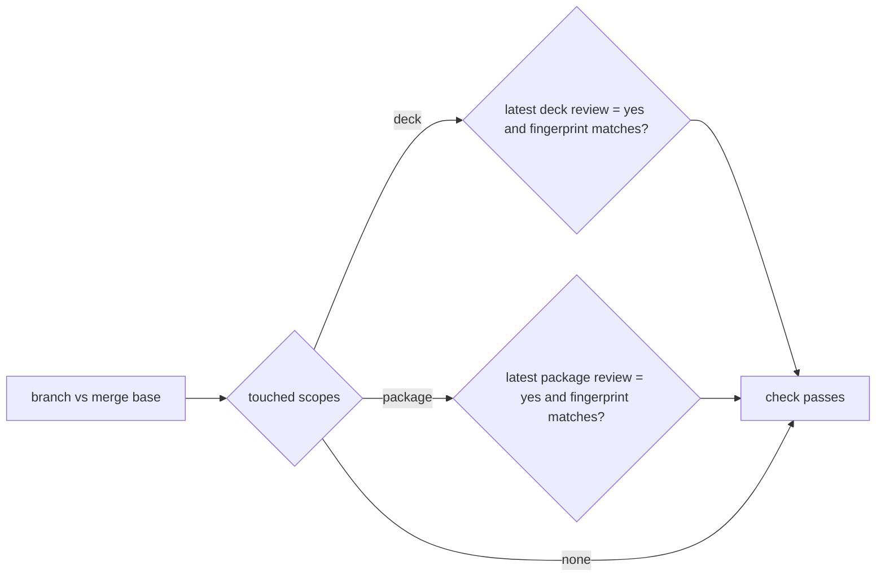

# Gate Review Pack — Plan gate: Story 2.2, ledger v2 and check every touched scope

**Spec**: `specs/012-ledger-v2/` · **Issue**: #12 · **Date**: 2026-10-15 · **Decision**: yes (2026-10-15, presenter; quiz passed first try)

## Summary (read aloud)

Story two point two gives understand-gate its own gate log. When you say yes or no, one line is written for each area the change belongs to, with that area's fingerprint and your quiz result. Before a merge, the check finds which areas the branch changed and passes only if each of them has your latest yes on its current code. A branch that only changes planning documents needs no yes. A stats command shows how often you passed the quiz on the first try, so we can see if the quiz is too easy.

## Stories

| Story | What you get |
|---|---|
| US1 (P1) | `record`: one ledger line per scope, refused if the scope has uncommitted changes |
| US2 (P1) | `check --base origin/main`: every touched scope needs a matching review yes; `--all` for every scope |
| US3 (P2) | `stats`: first-try rate, re-explanations, no count |

## Tasks

| Id | Task | File |
|---|---|---|
| T001–T002 | Arg parser; ledger never in a scope | `src/args.mjs`, `src/scopes.mjs` |
| T003–T004 | record (tests first) | `src/ledger.mjs` |
| T005–T006 | check over touched scopes (tests first) | `src/touched.mjs` |
| T007–T008 | stats (tests first) | `bin/understand-gate.mjs` |
| T009–T010 | README, verify | — |

## Estimate

| Hours | Points | Tokens | Dollars |
|---|---|---|---|
| 1.5 | 5 | ~600k | ~$9 |

## Diagram

## Risks

- Only the review stage is enforced; plan and implement lines are for the record and stats.
- Locally, uncommitted changes count as touched; in CI only commits exist, so both agree on a clean tree.
