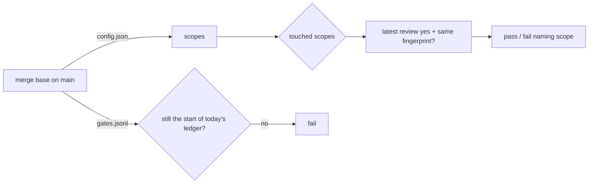

# Gate Review Pack — Review gate: Story 2.2, ledger v2 and check every touched scope

**PR**: [#13](https://github.com/400kelvins/ai-driven-sdlc/pull/13) · **Issue**: #12 · **Date**: 2026-10-15 · **Decision**: yes (2026-10-15, presenter reviewed the PR; quiz right after two re-explains)

## Summary (read aloud)

Story two point two is ready for your review. The local AI reviewer found three serious holes, all about a branch passing its own check. Two are fixed: the check now reads the areas from the main branch, so a branch cannot shrink them, and old ledger lines can no longer be changed or deleted. The third, a branch writing a fake yes line, needs proof that the yes came from you, which is story two point four. Six smaller issues: five fixed, one deferred. The AI review on GitHub was skipped for credit, so you are the reviewer for the pull request.

## AI review (local reviewer; the PR's AI review was skipped for credit)

| Finding | Status |
|---|---|
| 🔴 A branch edits `config.json` to shrink a scope, so its own change counts as untouched | ✅ fixed: `check --base` uses the config at the merge base; test |
| 🔴 A branch rewrites or deletes an earlier `no` in the ledger | ✅ fixed: the ledger at the merge base must be the exact start of the current one; 2 tests |
| 🔴 A branch appends a fake `yes` line | ⏭ Story 2.4 (proof of a human yes); the old gate has the same hole today |
| 🟡 A shallow clone can hide changed files | ✅ fixed: check refuses shallow clones; test |
| 🟡 `--all x` silently ran the weaker touched-only check | ✅ fixed: usage error; test |
| 🟡 `null`, array, or number ledger lines crashed or were skipped | ✅ fixed: every line needs text fields; test |
| 🟡 Repeated flags, or value flags with no value, were accepted | ✅ fixed: refused; test |
| 🟡 A write cut short swallowed the next line | ✅ fixed: next record starts a fresh line; the broken line is reported; test |
| 🟡 Flag value errors exit 1, not 2 | Kept: 1 = failure, matching Story 2.1 |
| 🟡 Deleting every file in a scope blocks the PR | ⏭ Story 2.7 sweep (availability, not a bypass) |

## Tests

- **131 unit** (+29 for this Story) · **20 e2e** · build · notes leak ✅
- Live on this branch: `check --base origin/main` → `package: no review decision` (expected until the new gate is used in 2.6)

## Diagram

## Quiz

A branch changes package code and also edits `config.json` so the package scope covers nothing. Which config does `check --base origin/main` use?
