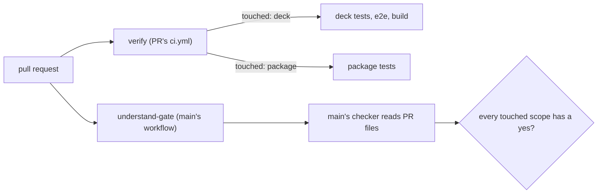

# Gate Review Pack — Implement gate: Story 2.3, CI runs the checker and config from main

**Spec**: `specs/013-ci-from-main/` · **Issue**: #14 · **Date**: 2026-10-15 · **Decision**: yes (2026-10-15, presenter; quiz passed first try)

## Summary (read aloud)

Story two point three is built. The new understand-gate check runs from main, with a read-only token, and only reads the pull request's files. Recording a gate decision now writes both logs. The verify check runs deck tests only when the deck changed, and package tests only when the package changed. Twelve of thirteen tasks are done and every test passes, including nine new ones. The last task is yours, after merge: add the new check to the branch rules, then we prove it with a throwaway pull request.

## Tasks

| Planned | Done | Left |
|---|---|---|
| 13 | 12 | T013 after merge (you: branch protection; then live throwaway PR) |

## Verify

| Check | Result |
|---|---|
| Unit | ✅ 140 (131 existing + 9 new) |
| E2E | ✅ 20 |
| Build, notes leak | ✅ |
| `understand-gate touched --base origin/main` on this branch | `deck`, `package` |

## Diff since the plan gate

```text
 .github/workflows/understand-gate.yml   | new: pull_request_target, main's checker, PR head as data
 .github/workflows/ci.yml                | verify: Areas step, deck/package steps gated
 .github/workflows/pr-visuals.yml        | paths-ignore packages/specs/_bmad-output
 .github/branch-protection.json          | + understand-gate
 .github/CODEOWNERS                      | new
 scripts/gate-record.mjs, package.json   | gate:record writes both ledgers; test:deck, verify:deck
 packages/understand-gate/bin            | touched command (shares check's code)
 tests (3 files)                         | touched, dual record, workflow structure
 13 files changed, 343 insertions, 35 deletions
```

## Diagram



## Notes

- If the new ledger write fails after the old one succeeds, the old line stays; the new ledger is checked separately. The old ledger goes in Story 2.6.
- `verify`'s `touched` step uses the PR's own checker; that only chooses which tests run. The gate itself is `understand-gate`, from main.

## Estimate vs actual

| Measure | Estimate | Actual |
|---|---|---|
| Time | 2 h | ~50 min so far |
| Story points | 5 | 5 |

## Quiz

A pull request changes only `packages/understand-gate/src/scopes.mjs`. Which tests does `verify` run?
