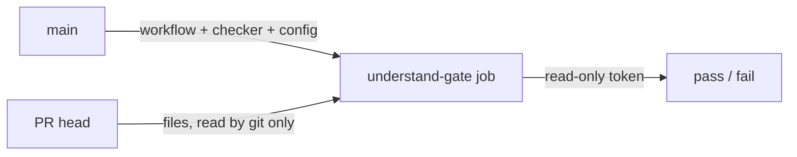

# Gate Review Pack — Plan gate: Story 2.3, CI runs the checker and config from main

**Spec**: `specs/013-ci-from-main/` · **Issue**: #14 · **Date**: 2026-10-15 · **Decision**: yes (2026-10-15, presenter; quiz right on the third try)

## Summary (read aloud)

Story two point three makes the gate hold even against the branch it judges. A new check called understand-gate runs from the main branch: the workflow, the checker, and the area config all come from main, and the pull request's files are only read, never run. When you answer a gate, your decision is now written to both logs, so the old and new checks can both pass until story two point six. Tests run only for the area that changed. After merge, you add the new check to the branch rules, and we prove it with a throwaway pull request.

## Stories

| Story | What you get |
|---|---|
| US1 (P1) | Required check `understand-gate`, from main, read-only, no PR code run |
| US2 (P1) | `npm run gate:record` writes old log + understand-gate ledger for touched scopes |
| US3 (P2) | `verify` runs deck steps only on deck changes, package tests only on package changes |

## Tasks

| Id | Task | File |
|---|---|---|
| T001–T002 | `touched --base` command (tests first) | `bin/understand-gate.mjs` |
| T003–T005 | New workflow, structural test, protection file | `.github/workflows/understand-gate.yml` |
| T006–T007 | Dual record (tests first) | `scripts/gate-record.mjs` |
| T008–T010 | Path filters in `verify`, visuals `paths-ignore` | `.github/workflows/ci.yml` |
| T011–T012 | CODEOWNERS, README, verify | — |
| T013 | **You**: apply protection; live throwaway PR | — |

## Estimate

| Hours | Points | Tokens | Dollars |
|---|---|---|---|
| 2 | 5 | ~700k | ~$10 |

## Diagram

## Risks

- `pull_request_target` has repository access: read-only token, no install, no PR code run.
- A fake job with the same name in a PR's own workflow is a residual gap (not verified either way).
- The new check cannot run on this PR itself; it starts with the next one.
