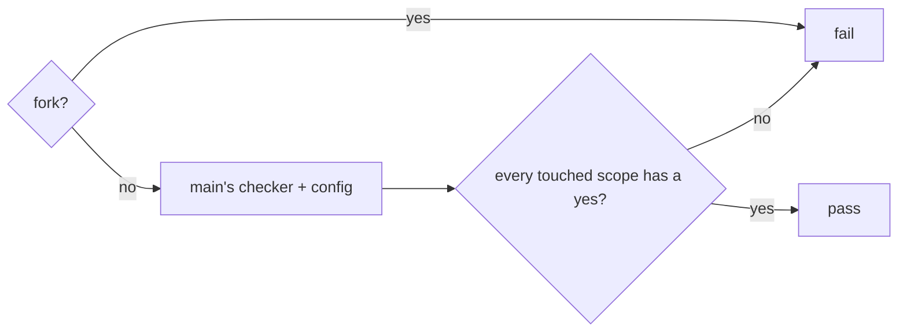

# Gate Review Pack — Review gate: Story 2.3, CI runs the checker and config from main

**PR**: [#15](https://github.com/400kelvins/ai-driven-sdlc/pull/15) · **Issue**: #14 · **Date**: 2026-10-15 · **Decision**: yes (2026-10-15, presenter reviewed the PR; quiz right on the third try)

## Summary (read aloud)

Story two point three is ready for your review. The local AI reviewer found three serious issues. One is fixed: a pull request from a fork used to be skipped, and GitHub counts a skipped required check as passing, so now it fails instead. The second, the agent recording a yes by itself, is exactly what story two point four fixes. The third, a fake job with the same name, needs GitHub rulesets, which I propose as a follow-up. Three smaller issues are fixed and one is documented. You are the reviewer for the pull request.

## AI review (local reviewer; the PR's AI review was skipped for credit)

| Finding | Status |
|---|---|
| 🔴 Fork PR: a skipped required check counts as passing | ✅ fixed: the job always runs and fails for forks; test |
| 🔴 The agent can run `gate:record` and commit a yes, no human needed | ⏭ Story 2.4 (proof of a human yes); documented in the README |
| 🔴 A PR can add its own job named `understand-gate` | ⏭ follow-up: GitHub rulesets "require workflows to pass", pinned to main (to confirm it is available on this repository) |
| 🟡 No config at the merge base fell back to the branch's own config | ✅ fixed: refused; test |
| 🟡 `gate:record` could write the old ledger, then fail on the new one | ✅ fixed: dry-run first; test with `--confidence 9`, `--attempts 0`, `--first-try perhaps` |
| 🟡 CODEOWNERS missed `package.json`, `tests/`, `.specify/` | ✅ fixed |
| 🟡 `verify` uses the PR's own `touched`, so a PR can skip its tests | Documented: `verify` is not the trust boundary; the PR controls `ci.yml` anyway |

## Tests

- **142 unit** (+11 for this Story) · **20 e2e** · build · notes leak ✅

## After merge (T013, you)

1. `npm run protect:main` adds `understand-gate` to the required checks.
2. I open a throwaway PR that changes package code and shrinks the package scope in `config.json`; `understand-gate` must fail. Then I close it unmerged.

## Diagram

## Sources

- Rulesets on free public repositories: [GitHub docs, troubleshooting rules](https://docs.github.com/en/enterprise-server@3.16/repositories/configuring-branches-and-merges-in-your-repository/managing-rulesets/troubleshooting-rules)
- Required workflows moved to rulesets: [GitHub docs, required workflows](https://docs.github.com/en/enterprise-server@3.9/actions/using-workflows/required-workflows)

## Quiz

Before the fix, a fork opened a PR. The `understand-gate` job was skipped. What did GitHub do with the required check?
