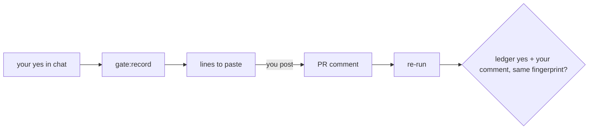

# Gate Review Pack — Implement gate: Story 2.4, proof of a human yes by PR comment

**Spec**: `specs/014-comment-proof/` · **Issue**: #18 · **Date**: 2026-10-15 · **Decision**: yes (2026-10-15, presenter; quiz passed first try)

## Summary (read aloud)

Story two point four is built. The understand-gate check now wants your comment on the pull request, one line per area, with the exact fingerprint. The proof rules come from main, so a branch cannot switch them off. Posting your comment re-runs the check. After a review yes, the record command prints the lines for you to paste. Ten of eleven tasks are done and every test passes, including thirteen new ones. The last task is a live proof after merge, and it starts with this very pull request's successor.

## Tasks

| Planned | Done | Left |
|---|---|---|
| 11 | 10 | T011 live proof after merge |

## Verify

| Check | Result |
|---|---|
| Unit | ✅ 156 (143 existing + 13 new) |
| E2E | ✅ 20 |
| Build, notes leak | ✅ |

## Diff since the plan gate

```text
 packages/understand-gate/src/proof.mjs        | comment line, proof match, comments reader
 packages/understand-gate/bin, src/scopes.mjs  | --comments; proof + reviewers validated, from main's config
 .understand-gate/config.json                  | proof: comment, reviewers: [400kelvins]
 .github/workflows/understand-gate.yml         | fetch PR comments → --comments
 .github/workflows/understand-gate-rerun.yml   | new: a yes comment re-runs the check
 scripts/gate-record.mjs                       | prints the lines to paste after a review yes
 .claude/skills/speckit-gate/SKILL.md          | ask the human to post the lines; never post them yourself
 14 files changed, 311 insertions, 28 deletions
```

## What changes for you, from the next PR

1. At the review gate you say yes, as today.
2. I show lines like `/understand-gate yes deck 1afa…`.
3. You paste them as a comment on the PR. The check re-runs and turns green. Then you merge.

## Diagram



## Estimate vs actual

| Measure | Estimate | Actual |
|---|---|---|
| Time | 1.5 h | ~45 min |
| Story points | 5 | 5 |

## Quiz

Who should post the `/understand-gate yes …` comment, and why?
