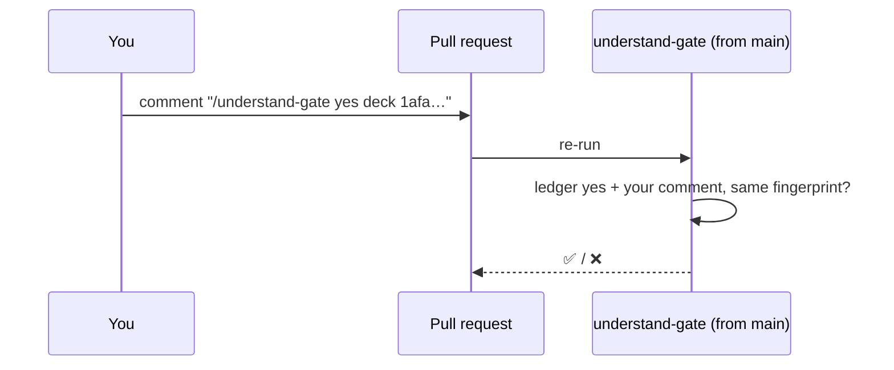

# Gate Review Pack — Plan gate: Story 2.4, proof of a human yes by PR comment

**Spec**: `specs/014-comment-proof/` · **Issue**: #18 · **Date**: 2026-10-15 · **Decision**: yes (2026-10-15, presenter; quiz passed first try)

## Summary (read aloud)

Story two point four puts your yes on the pull request. After you say yes at the review gate, I print one line per area, and you paste it on the pull request from your account. The understand-gate check passes only when each touched area has your line with its exact fingerprint. Posting the comment re-runs the check by itself, so you never push again. As we discussed, an agent using your login could post that line too; the docs say so plainly.

## Stories

| Story | What you get |
|---|---|
| US1 (P1) | Check needs `/understand-gate yes <scope> <fingerprint>` from a listed reviewer, per touched scope |
| US2 (P1) | Posting the comment re-runs the check (no new push) |
| US3 (P2) | `gate:record` prints the lines to paste |

## Tasks

| Id | Task | File |
|---|---|---|
| T001–T003 | Comment proof in the checker (tests first); config `proof`, `reviewers` | `src/proof.mjs`, `.understand-gate/config.json` |
| T004–T006 | CI fetches comments; re-run workflow; structural tests | `.github/workflows/` |
| T007–T008 | Lines to paste; gate skill | `scripts/gate-record.mjs`, `speckit-gate` |
| T009–T011 | README, verify, live proof after merge | — |

## Estimate

| Hours | Points | Tokens | Dollars |
|---|---|---|---|
| 1.5 | 5 | ~600k | ~$9 |

## Diagram

## Risks

- Comment proof shows involvement but does not stop an agent with your login (your choice; documented).
- The re-run workflow needs permission to re-run Actions; it runs no pull request code and checks out nothing.
