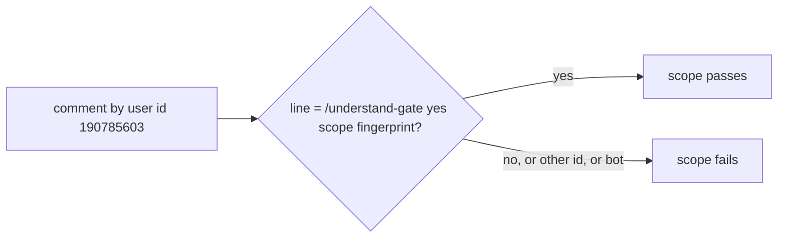

# Gate Review Pack — Review gate: Story 2.4, proof of a human yes by PR comment

**PR**: [#19](https://github.com/400kelvins/ai-driven-sdlc/pull/19) · **Issue**: #18 · **Date**: 2026-10-15 · **Decision**: yes (2026-10-15, presenter reviewed the PR; quiz passed first try)

## Summary (read aloud)

Story two point four is ready for your review. The local AI reviewer found one serious issue: reviewers were matched by login name, and GitHub frees a renamed account's old name for anyone to take. Now your comment is matched by your numeric GitHub user id. The re-run helper is sturdier: it reacts when a yes line is added, edited away, or deleted, only for people with write access, and it fails loudly if it cannot find the run. I also confirmed on a real pull request that CI reads comments correctly. You are the reviewer for the pull request.

## AI review (local reviewer; the PR's AI review was skipped for credit)

| Finding | Status |
|---|---|
| 🔴 Reviewer matched by login; a renamed account's login can be re-claimed | ✅ fixed: matched by user id (`400kelvins` = `190785603`); 2 tests |
| 🟡 Re-run looked at only 50 runs and exited quietly | ✅ fixed: all pages; fails loudly if none |
| 🟡 Re-run of a run in progress errors | ✅ fixed: waits, then re-runs |
| 🟡 Editing the line away or deleting the comment did not re-run | ✅ fixed: `deleted` + edits where the old text had the line |
| 🟡 Anyone's comment could trigger re-runs | ✅ fixed: owners and collaborators only |
| 🟡 A re-run reuses the original run's event | Documented: a config change on main applies from the next push |
| 🟡 `check --all` reads the branch's own config | Documented: local only; CI uses `--base` |
| ❓ Does CI's `gh --jq ... tojson` give one comment per line? | ✅ verified on PR #19: 2 comments, 2 lines, multi-line bodies escaped |

## Tests

- **157 unit** (+14 for this Story) · **20 e2e** · build · notes leak ✅

## After merge (T011)

The next pull request needs your comment. That is the live proof: it fails until you post the lines, then passes without a push.

## Diagram

## Quiz

Someone creates a new GitHub account and names it `400kelvins` after you renamed yours. They post your exact yes line. Does it count?
