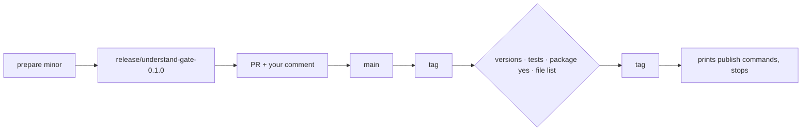

# Gate Review Pack — Implement gate: Story 2.5, release script and read-listen-see alias

**Spec**: `specs/015-release/` · **Issue**: #20 · **Date**: 2026-10-15 · **Decision**: yes (2026-10-15, presenter; quiz passed first try)

## Summary (read aloud)

Story two point five is built. The release script has two steps, prepare and tag, and the tag step stops before anything leaves your machine. The read-listen-see alias gives exactly the same output as understand-gate. npm would publish only the command, its source, the readme, and the license, never the tests. Two real bugs were found while testing: running tests on a folder ran nothing, and tests run inside other tests always passed. Both are fixed. Nine of ten tasks are done; the last is your first yes comment on this pull request.

## Tasks

| Planned | Done | Left |
|---|---|---|
| 10 | 9 | T010: your first `/understand-gate yes` comment, on this PR |

## Verify

| Check | Result |
|---|---|
| Unit | ✅ 166 (157 existing + 9 new) |
| E2E | ✅ 20 |
| Build, notes leak | ✅ |
| `npm pack --dry-run` understand-gate | `LICENSE README.md bin/understand-gate.mjs package.json src/*.mjs` (no tests, no scripts) |
| `npm pack --dry-run` read-listen-see | `LICENSE README.md bin/read-listen-see.mjs package.json` |
| `npx read-listen-see fingerprint --scope deck` | same as `understand-gate` |

## Bugs caught while building

| Bug | Fix |
|---|---|
| `node --test <folder>` runs no tests, so `tag` passed on failing tests | explicit list of test files |
| A `node --test` started inside another test run reports upward and exits 0 | the release script clears `NODE_TEST_CONTEXT` |

## Diagram

## Estimate vs actual

| Measure | Estimate | Actual |
|---|---|---|
| Time | 1.5 h | ~55 min |
| Story points | 3 | 3 |

## Quiz

`release tag` finds that the package tests fail. What does it do?
