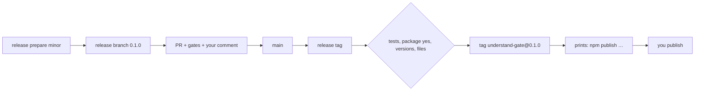

# Gate Review Pack — Plan gate: Story 2.5, release script and read-listen-see alias

**Spec**: `specs/015-release/` · **Issue**: #20 · **Date**: 2026-10-15 · **Decision**: yes (2026-10-15, presenter; quiz passed first try)

## Summary (read aloud)

Story two point five gets understand-gate ready to publish. Because main is protected, a release has two steps. Prepare makes a branch that bumps both packages to the new version, and that branch goes through a pull request and the gates. After it merges, tag checks the tests and your package yes, shows exactly which files npm would publish, creates the version tag, and stops. You run the publish commands yourself. The read-listen-see alias behaves exactly like understand-gate. This pull request is also the first one that needs your yes comment.

## Stories

| Story | What you get |
|---|---|
| US1 (P1) | `release prepare <patch\|minor\|major>` → release branch with both versions bumped |
| US2 (P1) | `release tag` → checks, file list, tag, then stops with the publish commands |
| US3 (P2) | `npx read-listen-see` = `npx understand-gate` |

## Tasks

| Id | Task | File |
|---|---|---|
| T001–T002 | Publishing fields, LICENSE, alias package, scope | `packages/*/package.json` |
| T003–T006 | prepare and tag (tests first) | `packages/understand-gate/scripts/release.mjs` |
| T007 | Alias test | `tests/alias.test.mjs` |
| T008–T010 | README, verify, your first yes comment | — |

## Estimate

| Hours | Points | Tokens | Dollars |
|---|---|---|---|
| 1.5 | 3 | ~500k | ~$8 |

## Diagram

## Risks

- The first publish to npm is public and hard to undo; the script never runs it.
- `npm login` is needed once, by you.
