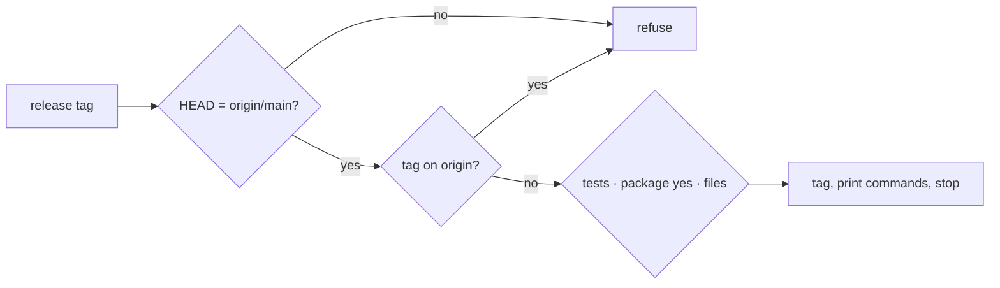

# Gate Review Pack — Review gate: Story 2.5, release script and read-listen-see alias

**PR**: [#21](https://github.com/400kelvins/ai-driven-sdlc/pull/21) · **Issue**: #20 · **Date**: 2026-10-15 · **Decision**: yes (2026-10-15, presenter reviewed the PR; quiz passed first try)

## Summary (read aloud)

Story two point five is ready for your review. The local AI reviewer found one serious bug: a version like one point zero point zero dash r c one turned into one point zero point not a number. Now only plain versions are accepted. The tag step now also refuses anything that is not exactly what GitHub has on main, and refuses a tag that already exists on GitHub. A failed lockfile update no longer leaves a half-made branch. The alias reports errors and signals properly, and the package only exposes its command. After your yes, this is the first pull request where you post your yes comment.

## AI review (local reviewer; the PR's AI review was skipped for credit)

| Finding | Status |
|---|---|
| 🔴 `1.0.0-rc.1` bumped to `1.0.NaN` | ✅ fixed: plain `x.y.z` only; test |
| 🟡 `tag` could tag local commits not on origin | ✅ fixed: HEAD must equal origin/main; test |
| 🟡 A tag on origin but not local was missed | ✅ fixed: `ls-remote` check; test |
| 🟡 Lockfile failure left a half-made branch | ✅ fixed: edit first, roll back, then branch; offline-first, 2-min timeout |
| 🟡 Alias dropped signals and start errors | ✅ fixed: 128+signal; error message |
| 🟡 No `exports`: internal files importable | ✅ fixed: only the CLI and package.json exported |
| 🟡 No-push test missed the `git()` helper | ✅ fixed |
| 🟡 Importing the script ran it | ✅ fixed: nothing exported |
| ❓ `tag` checks the ledger yes, not the comment | Kept: on main a yes arrives only via a merged PR, which needed your comment; noted in code |

## Tests

- **169 unit** (+12 for this Story) · **20 e2e** · build · notes leak ✅
- `stats` on the real ledger: 10 of 12 first-try (83%), 4 re-explanations

## After your yes

I print your lines; you paste them on PR #21; `understand-gate` re-runs and turns green. This is Story 2.4's live proof.

## Diagram

## Quiz

You have a local commit on main that is not on GitHub yet. You run `release tag`. What happens?
