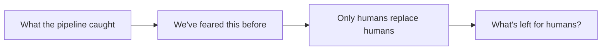

# Gate Review Pack — Plan + implement gate (fast track): Story 15, we've feared this before

**Spec**: `specs/017-fear-slides/` · **Issue**: #23 · **Date**: 2026-10-15 · **Decision**: yes (2026-10-15, presenter; fast track; quiz passed first try)

## Summary (read aloud)

Two new slides sit right before "What's left for humans". The first shows the fear is old, with three real photos: the Luddites in 1812, a telephone operator in 1911, and two women running the ENIAC computer in 1946. Then ATMs, where bank teller jobs went up, and AI today. The second slide says only humans replace humans: about sixty percent of American jobs in 2018 did not exist in 1940. All photos are public domain and stored in the repo, every number names its source, and the talk is now about thirteen minutes.

## Slides

| # | Slide | Key line |
|---|---|---|
| 16 | We've feared this before | 1812 looms · 1911 telephones · 1946 computers · ATMs · AI today |
| 17 | Only humans replace humans | "AI won't replace you. A person who learns to use it will." |

## Sources

| Item | Source | Licence |
|---|---|---|
| Luddite engraving, 1812 | Wikimedia Commons `File:Luddite.jpg` | Public domain |
| "A Telephone Operator", 1911 | Library of Congress via Commons | Public domain (pre-1929) |
| Two women operating ENIAC, 1946 | U.S. Army Photo via Commons | Public domain (US government) |
| ATMs 60,000 → 352,000; tellers 500,000 → 527,000 (1985–2002) | Bessen, IMF F&D 2015 (as reported) | — |
| ~60% of 2018 jobs in types that didn't exist in 1940 | Autor et al., NBER w30389, 2022 | — |

## Verify

- **170 unit** · **23 e2e** (+3) · build · notes leak ✅ · talk ~13.0 min · 0 remote image URLs

## Diagram

## Quiz

Where do the three photos load from when you present?
