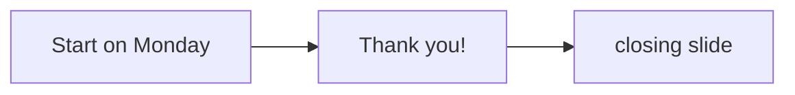

# Gate Review Pack — Live demo: Thank you!

**PR**: [#37](https://github.com/400kelvins/ai-driven-sdlc/pull/37) · **Issue**: #35 · **Commit**: `b906694` · **Decision**: yes, 2026-10-15

## Summary (read aloud)

You asked for a thank-you slide in your deck, and this time with a Questions line. I added one slide, titled Thank you, with the line Questions, ask me anything, right after Start on Monday and before the closing slide. The pull request is open and waiting for your decision.

## What was done

| Area | Result | Evidence |
|---|---|---|
| Slide | "Thank you!" + "Questions? Ask me anything." + speaker notes | `pages/talk.md` |
| Tests | 3/3 content checks; talk time ~16.3 min | `tests/content.spec.ts` |
| Earlier version | PR #36, "Go build it" line: No at the gate | closed |
| Hand-written code | 0 lines | Constitution I |

## Diagram

