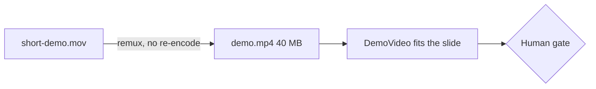

# Gate Review Pack — Demo video on slide 28 (second review)

**Gate**: review → ship | **Date**: 2026-10-15 | **Commit**: `9a7a4b0` | **Decision**: yes, 2026-10-15

## Summary (read aloud)

You said no because the video was cropped at the top and bottom, and you did not want it compressed. Both are fixed. The player was sized to the browser window, but the slide is scaled up, so the video overflowed; it now fits inside the slide at every screen size I tested, and the whole frame is visible. The video is now your original recording at full quality, sixty frames per second, without re-encoding. All tests pass.

## What was done

| Area | Result | Evidence |
|---|---|---|
| Your no (2026-10-15) | "the video is cropped, my demo is at top and at the bottom, full screen should be visible, also don't compress, it goes on big projector" | `demo-video-review.md` |
| Crop cause | `max-h-[70vh]` measured the window, but Slidev scales the slide about 2×: video was 1479 px tall in a 1080 px window, top at −145 px | Playwright bounding box |
| Crop fix | Video fills the space under the title and fits by `object-contain` | `components/DemoVideo.vue`, `pages/demo.md` |
| Fully visible | Whole frame inside the screen at 1920×1080, 1280×720, 1024×768 (4:3 projector) | temporary Playwright test, removed after |
| Quality | Original H.264 stream, not re-encoded: 1478×1398, 60 fps, 95 s, 40 MB; metadata tags stripped | `ffprobe` |
| Tests | 170/170 unit, 29/29 end-to-end; no speaker notes in `dist/` | `npm run verify` |
| Hand-written code | 0 lines | Constitution I |

## Diagram

## AI code review — findings and actions

| Severity | Finding | Action |
|---|---|---|
| 🔴 | Video overflowed the slide; top and bottom cut off | Fixed |
| 🟡 | Video was re-encoded at CRF 28, 30 fps: soft on a projector | Fixed: original stream |
| 🟡 | The recording is public once shipped; sampled frames show no tokens or email addresses | Human: confirm the full 95 s is fine to publish |
| 🔵 | Title takes about a fifth of the slide height; the player's fullscreen button fills the projector | Ignored: title is the section marker the tests find |

## AI review on the PR

_No pull request for this branch._ The commits are on local `main`, which is protected on GitHub.

## Notes

- `npm run ship` deploys this local tree; open a PR afterwards so GitHub `main` matches the live deck.
