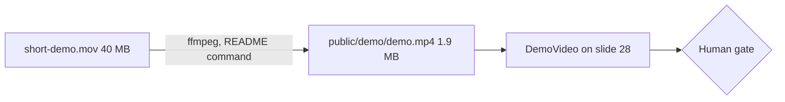

# Gate Review Pack — Demo video on slide 28

**Gate**: review → ship | **Date**: 2026-10-15 | **Commit**: `cd0e74b` | **Decision**: no, 2026-10-15: "the video is cropped, my demo is at top and at the bottom, full screen should be visible, also don't compress, it goes on big projector"

## Summary (read aloud)

I added your demo recording to slide twenty eight, Demo: Voice to Production. The slide already had a video player, so no slide code changed; only the video file was added. I compressed it from forty megabytes to under two, and it plays in the browser for the full ninety five seconds. All one hundred seventy unit tests and twenty nine end to end tests pass. Please confirm you are happy for this recording to be public, then say yes to ship.

## What was done

| Area | Result | Evidence |
|---|---|---|
| Change | 1 file added: `public/demo/demo.mp4` | commit `cd0e74b` |
| Video | H.264, 1142×1080, 30 fps, 95 s, 1.9 MB, faststart, no audio track (source had none) | `ffprobe` |
| Plays on slide 28 | Real file played in Chromium, duration 95 s | temporary Playwright test, removed after |
| Tests | 170/170 unit, 29/29 end-to-end | `npm run verify` |
| Build | `dist/demo/demo.mp4` present; no speaker notes in `dist/` | `npm run verify` |
| Hand-written code | 0 lines | Constitution I |

## Diagram

## AI code review — findings and actions

| Severity | Finding | Action |
|---|---|---|
| 🔵 | Source `.mov` carried `creation_time` and Apple `ReplayKitRecording` author tags | Checked: not in the MP4 (ffmpeg did not copy them) |
| 🟡 | Recording shows a terminal session that is public once shipped. Sampled frames (every 8 s) show no tokens or email addresses; narration says "your old Gmail address" but the address itself is not seen in samples | Human: confirm the full 95 s is fine to publish |
| 🔵 | First ~40 s are mostly an empty terminal while text is read aloud | Ignored: content choice, not a defect |

## AI review on the PR

_No pull request for this branch._ The commit is on local `main`, which is protected on GitHub: it reaches GitHub only through a pull request.

## Notes

- `npm run ship` deploys from this local tree, so the live deck will get the video before GitHub `main` does. Open a PR afterwards to keep them in step.
