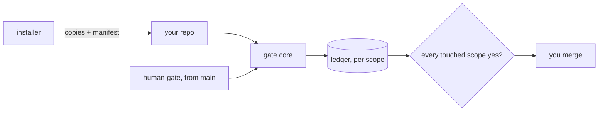

# Gate Review Pack — Plan gate: understand-gate architecture

**Spine**: `_bmad-output/initiative-ai-driven-sdlc/architecture-sdlc-blueprint-package/architecture-sdlc-blueprint-package.md` · **Date**: 2026-10-14 · **Decision**: yes (2026-10-14, presenter; quiz passed first try)

## Summary (read aloud)

The architecture for understand-gate is drafted. The installer copies everything into your repository, and your repository owns it after that. A manifest remembers each file, so update and uninstall never touch a file you edited. Your yes is stored per scope, so a deck yes cannot cover package code. The check on GitHub runs from main, with main's config, so a pull request cannot weaken its own gate. A yes needs proof from you: a pull request comment by default, or a signed commit in strict mode. You publish to npm yourself. By the end of the first epic, this repository uses the package on itself.

## Diagram

## Tasks (decisions)

| AD | Decision |
|---|---|
| 1 | Copy-in, tracked by a manifest |
| 2 | Checker and config run from main |
| 3 | Scopes: every touched scope needs a yes |
| 4 | One append-only ledger |
| 5 | Proof: PR comment (default) or signed commit |
| 6 | Fixed review-pack headings |
| 7 | Nothing leaves the repo |
| 8 | One skill source, copied per agent |
| 9 | Upstreams pinned ≥ 2 weeks old: spec-kit v1.0.13, bmad-method 6.12.0 |
| 10 | Human publishes; this repo dogfoods |

## Walkthrough

- Lint: 0 findings. Adversarial pass closed 3 holes: config from main, "touched" defined, ledger + proof both required.
- Deferred: BMad V7, next tracker, Linux speech, own repo, telemetry, team roles.

## Quiz

A pull request changes `config.json` to drop the `package` scope, plus package code. What happens?
