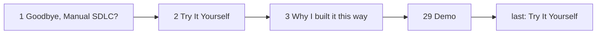

# Gate Review Pack — Try It Yourself as slide 2

**Gate**: review → ship | **Date**: 2026-10-15 | **Commit**: `4ff2e50` | **Decision**: yes, 2026-10-15

## Summary (read aloud)

Try It Yourself is now slide two, right after the title, so the room can scan both QR codes at the start. It also stays as the closing slide. Both slides share one QR component, and both codes decode to the right addresses on both slides. Slide two has its own speaker notes, because the closing notes end with thank you. Every slide after the title moved down by one, so the demo is now slide twenty nine. All tests pass.

## What was done

| Area | Result | Evidence |
|---|---|---|
| New slide 2 | "Try It Yourself", deck and repo QR codes | `pages/try-early.md`, imported in `pages/intro.md` |
| Shared QR codes | One component for both slides | `components/TryItLinks.vue`, `pages/links.md` |
| Slide 2 notes | "Before we start: scan these now… I'll show them again at the end." | `pages/try-early.md` |
| Tests | 170/170 unit, 30/30 end-to-end; QR decode and size checked on both slides; new test: slide 2 is Try It Yourself | `npm run verify` |
| Tests updated | Section order uses last appearance; "Why I built it this way" now slide 3; presenter tests expect slide 2 | `tests/smoke.spec.ts`, `tests/font-why.spec.ts`, `tests/presenter.spec.ts` |
| Contract | Notes the slide-2 copy | `specs/001-deck-scaffold/contracts/deck-sections.md` |
| Hand-written code | 0 lines | Constitution I |

## Diagram

## AI code review — findings and actions

| Severity | Finding | Action |
|---|---|---|
| 🟡 | `slideNo('Try It Yourself')` now returns slide 2, so the links tests would only cover the opening slide | Fixed: links tests check every Try It Yourself slide |
| 🟡 | Smoke order check used the first appearance; the slide-2 copy would put the closing section out of order | Fixed: uses last appearance |
| 🔵 | Slide numbers after 1 shift by one; anyone quoting "slide 28" for the demo should say 29 | Noted |

## AI review on the PR

_No pull request for this branch._ The commits are on local `main`, which is protected on GitHub.

## Notes

- `npm run ship` deploys this local tree; open a PR afterwards so GitHub `main` matches the live deck.
