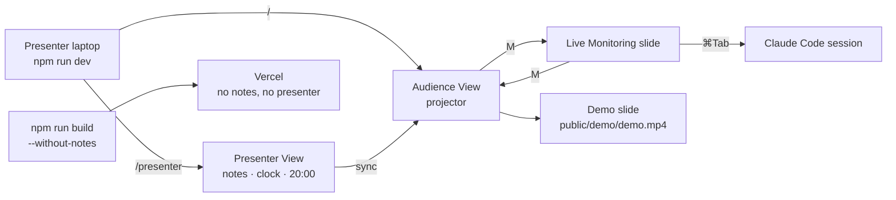

# Gate Review Pack — Stories 2–5

**Gate**: Stories 2–5 → Stories 6–7 | **Date**: 2026-10-12 | **Decision**: _pending (yes / no)_

## Summary (read aloud)

Stories two to five are built, tested, reviewed, and live. You now have a presenter view with your
notes, the time of day, and a twenty minute countdown. Press M to jump to live monitoring and M
again to come back. The demo slide is ready for your recording. The review found one real bug in
the read-aloud tool, which is fixed. Testing also caught that your speaker notes were leaking into
the public website, which is now fixed too. Eighteen tests pass. Next is your talk content.

## What was done

| Story | Result | Evidence |
|---|---|---|
| 2 Read-aloud Gate Review Pack | `npm run review:speak -- <file>`; template | `scripts/speak.mjs`, `templates/gate-review-pack.md` |
| 3 Presenter View | Notes, next slide, clock, 20:00 countdown; audience follows | `custom-nav-controls.vue`, `slides.md` |
| 4 Monitoring switch | **M** → Live Monitoring, **M** → back to the same slide | `setup/shortcuts.ts`, `pages/monitor.md` |
| 5 Demo video | Plays `public/demo/demo.mp4` offline; "Demo video unavailable" until added | `components/DemoVideo.vue` |
| Tests | 11 Playwright end-to-end + 7 node:test unit, all pass | `tests/` |
| Deploy | Ready, no errors; notes absent from live bundle | https://ai-driven-sdlc.vercel.app |
| Hand-written code | 0 lines | Constitution I |

## Estimate vs actual

| Story | Est. time | Actual (git) | Est. SP | Est. tokens | Est. $ | Test type |
|---|---|---|---|---|---|---|
| 2 | 0.75 h | ~2 min | 2 | 200k | 2 | node:test unit |
| 3 | 1 h | ~3 min | 3 | 300k | 3 | Playwright e2e (two windows) |
| 4 | 1 h | ~3 min | 3 | 250k | 2.5 | Playwright e2e |
| 5 | 0.5 h | ~2 min | 2 | 150k | 1.5 | Playwright e2e (video fixture) |
| Review fixes | — | ~3 min | — | — | — | — |
| **Total** | **3.25 h** | **~13 min agent time** | 10 | 900k | 9 | Actual tokens/$ at Story 9 |

## Diagram

## Found by testing (not by review)

| Finding | Action |
|---|---|
| `presenter: dev` hid the view but **notes text was still in the public JS bundle** | **Fixed**: `slidev build --without-notes`; live bundle checked, 0 matches |
| Slidev dev server syncs slides across all open pages, so parallel tests interfered | **Fixed**: tests run serially |
| M pressed before shortcuts registered | **Fixed**: tests wait for slide render |

## AI code review — findings and actions

| Severity | Finding | Action |
|---|---|---|
| 🔴 | Markdown stripper removed underscores inside words (`snake_case` → `snakecase`) | **Fixed** + test |
| 🟡 | `say` failure or kill reported success | **Fixed**: error handler, signal → exit 1 |
| 🟡 | Text passed to `say` as argument (option / `[[cmd]]` parsing) | **Fixed**: text via stdin; `[[ ]]` stripped + test |
| ❓ | M fires with Cmd held or while typing | **Fixed**: ignored with modifiers or in inputs + test |
| 🟡 | M return point survived manual navigation | **Fixed**: cleared on any other navigation + test |
| 🟡 | Fallback showed internal repo path to audience | **Fixed**: "Demo video unavailable"; path moved to notes + test |
| 🟡 | `preload="auto"` could download a 50 MB video on page load | **Fixed**: `preload="metadata"` |
| 🟡 | Unit test depended on a file outside the repo's code | **Fixed**: fixture in `tests/fixtures/` |
| 🟡 | Countdown assertion matched any "20" | **Fixed**: asserts the timer reads 20:00 |
| 🟡 | Test fixture path relative to cwd | **Fixed** |

## Deferred to Story 10 (refactor sweep)

- Tests run against the dev server, not the built `dist/` (from Story 1 review).
- Rewrite answers missing `/demo/*.mp4` with HTML (200) instead of 404.

## Needs you (hitl)

- **Story 5**: add your recording as `public/demo/demo.mp4` (MP4, under 3 min) — compression command in `public/demo/README.md`.
- **Story 6** (next): talk content — I draft slides and notes from the PRD, addendum, and your slide 5/6 notes; you edit wording and notes locally.
