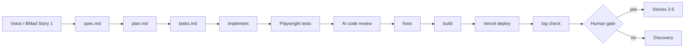

# Gate Review Pack — Story 1: Slidev scaffold with arrow-key navigation

**Gate**: Story 1 → Story 2/3/4/5 | **Date**: 2026-10-12 | **Decision**: _pending (yes / no)_

## Summary (read aloud)

Story one is built, tested, and live. The deck has seven sections in the planned order, and the
arrow keys move through them. It works with no network. It is live at ai-driven-sdlc dot vercel
dot app, with clean deploy logs. The AI code review found no critical issues; six medium issues
were fixed or moved to the refactor sweep. One spec line was corrected after a test showed how
the deck really behaves.

## What was done

| Area | Result | Evidence |
|---|---|---|
| Spec → plan → tasks → implement | spec-kit, 17/17 tasks | `specs/001-deck-scaffold/` |
| Arrow keys (→ ↓ next, ← ↑ back) | ✅ pass | `tests/smoke.spec.ts` |
| 7 sections in contract order | ✅ pass locally and live | `contracts/deck-sections.md` |
| Offline at runtime | ✅ pass (all off-host requests blocked in test) | smoke test `beforeEach` |
| Build | ✅ `npm run build` | `dist/` |
| Vercel deploy + log check | ✅ Build Completed, Ready, no errors | https://ai-driven-sdlc.vercel.app |
| Hand-written code | 0 lines | Constitution I |

## Estimate vs actual

| Measure | Estimate (Gate 1) | Actual |
|---|---|---|
| Time | 0.5 h | ~6 min agent time (19:48–19:54 UTC), plus setup and spec |
| Story points | 2 | 2 |
| Tokens | 150k | see Claude Code `/cost` at sprint end (Story 9) |
| Dollars | $1.50 | covered by subscription; API-equivalent at sprint end |
| Test type | — | Playwright end-to-end (Chromium), offline-enforced |

## Diagram

## AI code review — findings and actions

| Severity | Finding | Action |
|---|---|---|
| 🟡 | Catch-all rewrite hid missing assets (200 HTML) | **Fixed**: assets excluded; `/assets/nope.js` → 404 |
| 🟡 | Offline requirement untested | **Fixed**: test blocks all off-host requests |
| 🟡 | Possible flake during slide transition | **Fixed**: waits for previous slide to hide |
| 🟡 | Edge cases (held key, `/99`) untested | **Fixed**: tests added; spec amended — `/99` falls back to slide 1 |
| 🟡 | Node version not pinned; browser install undocumented | **Fixed**: `engines: 22.x`; quickstart updated |
| 🟡 | Tests run on dev server, not the built output | **Deferred** → Story 10 refactor sweep |
| 🔵 | Plan listed an `export` script | **Fixed**: plan amended |
| 🔵 | `reuseExistingServer` may test a stale server | Deferred → Story 10 |
| 🔵 | Dev console noise (FloatingVue, Wake Lock) | Harmless; Slidev-internal / headless only |
| ❓ | Intro loaded inside headmatter block | Intentional; works and tested |

## Notes

- Vercel's first deploy is assigned to production automatically; the deck is public at the URL
  above. The GitHub repo is still local (public publish is Story 7, needs your OK).
