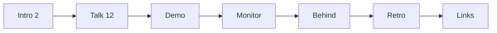

# Gate Review Pack — Story 6: 20-minute talk content

**Gate**: Story 6 → Story 7 | **Date**: 2026-10-12 | **Decision**: _pending (yes / no)_

## Summary (read aloud)

Your talk content is drafted and live. Fourteen new slides tell the story from the old life cycle to the new one, the read listen and see idea, the pipeline, the human gates, a real bug the pipeline caught, what is left for humans, and the honest costs. Every slide has speaker notes. Three things need you. The notes only fill about eight minutes, so expand them in your own words. Please check the three statistics on the costs slide against their original sources. And I made a process mistake: one deploy went out with a failing test, so I added a single verify and ship command that blocks any deploy unless every check passes.

## What was done

| Area | Result | Evidence |
|---|---|---|
| Slides | 14 new: Intro (2) + Talk (12); deck now 20 slides | `pages/intro.md`, `pages/talk.md` |
| Diagrams | Long flows use new `Flow` component (gates in amber); Mermaid shrank them unreadably | `components/Flow.vue` |
| Visual check | Every slide screenshotted; 4 layout problems found and fixed | contact sheets |
| Tests | 14 e2e + 7 unit pass; tests now find slides by title, not number | `tests/helpers.ts`, `tests/content.spec.ts` |
| Ship gate | `npm run verify` (unit, e2e, build, notes-leak) and `npm run ship` | `package.json`, `scripts/check-notes-leak.mjs` |
| Deploy | Ready, no errors, no notes in live build | https://ai-driven-sdlc.vercel.app |

## Estimate vs actual

| Measure | Estimate | Actual |
|---|---|---|
| Time | 2 h | ~9 min agent time (20:16–20:25 UTC) |
| Story points | 5 | 5 |
| Tokens / $ | 500k / $5 | at Story 9 |
| Test type | — | Playwright e2e + content checks + screenshot review |

## Diagram

## Found and fixed

| Severity | Finding | Action |
|---|---|---|
| 🔴 process | Deploy ran although a test failed (my command did not stop on failure) | **Fixed**: `npm run ship` deploys only after `verify` passes; redeployed |
| 🟡 | Title styling tag leaked into the slide title (and browser tab) | **Fixed**: slide-scoped style |
| 🟡 | Mermaid flows unreadable / overflowing | **Fixed**: `Flow` component |
| 🟡 | Tools table lost its last row; Gate Pack diagram cut off | **Fixed** |
| 🟡 | New slides broke number-based tests | **Fixed**: title lookup |
| ✅ | Notes-leak check proven: fails on a build with notes, passes on ours | — |

## Needs you (hitl)

1. **Timing**: notes ≈ 709 words ≈ 5 min spoken + 3 min demo ≈ 8 min. Expand notes in your voice toward 20 min (`npm run dev`, edit `pages/*.md`, commit as `content:`).
2. **Verify the statistics** on "The costs" — they came from secondary sources in research: METR 2025 (19% slower / felt 20% faster), DORA 2025 (stability), Faros AI (PR size +154%, review time +91%). Replace with the original links or drop.
3. Wording anywhere — the words are yours (Constitution I exception).
