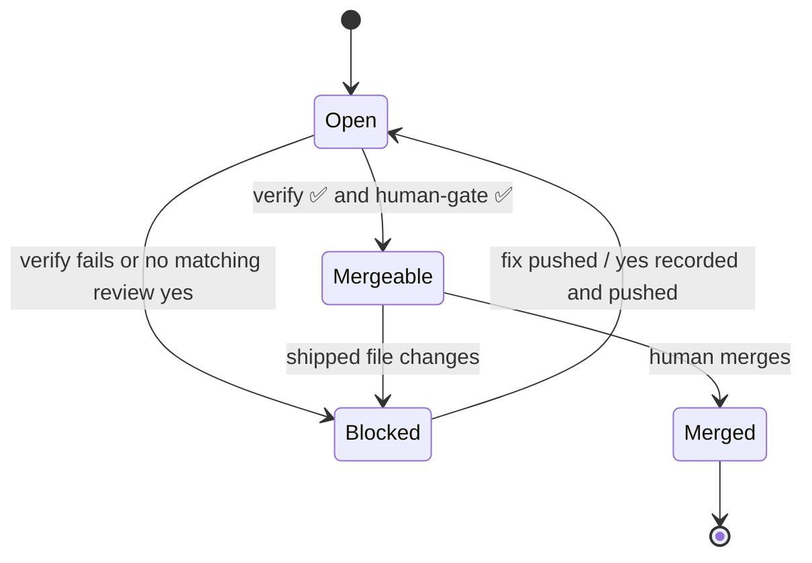

# Data Model: PR Workflow (spec 008)

## Required check

| Field | Values |
|---|---|
| name | `verify`, `human-gate` (must match the job names exactly; branch protection refers to them) |
| result | success / failure |
| reason | On failure, the last line of `gate:check` or the failing step |

## AI review comment

| Field | Rule |
|---|---|
| author | `github-actions[bot]` (or `claude[bot]` if the app is later installed) |
| marker | The body starts with `## AI code review` |
| body | Severity-tagged findings, or the words "No findings" |
| latest wins | If the PR has several marked comments, the gate pack uses the newest |

## Gate decision (existing)

Unchanged: `{ at, stage, story, decision, fingerprint, commit, note? }` in `gates.jsonl`. CI reads
it; only the human's answer, recorded locally, writes it.

## PR states

