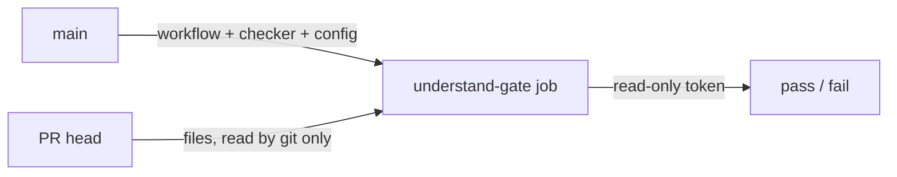

# Implementation Plan: CI Runs the Checker and Config from Main, with Path Filters

**Branch**: `013-ci-from-main` | **Date**: 2026-10-15 | **Spec**: [spec.md](spec.md)

## Summary

| Part | What |
|---|---|
| New workflow | `.github/workflows/understand-gate.yml`, `on: pull_request_target` (main), `permissions: contents: read`, job `understand-gate` |
| Job steps | checkout main → `base/`; checkout PR head (`fetch-depth: 0`) → `head/`; both `persist-credentials: false`; setup-node; in `head/`: `node ../base/packages/understand-gate/bin/understand-gate.mjs check --base origin/main`. No `npm ci`, no PR scripts |
| Forks | job skipped (`head.repo.full_name != github.repository`) → no result → blocked |
| CLI | new `understand-gate touched --base <ref>`: prints touched scope names, one per line (base config) |
| Dual record | `scripts/gate-record.mjs` behind `npm run gate:record`: old record, then `understand-gate record` for `touched --base origin/main` scopes |
| Path filters | `verify` job: `fetch-depth: 0`; step `areas` runs `touched`; deck steps (`playwright install`, deck unit, e2e, build, notes) `if: deck`; package step `npm test -w understand-gate` `if: package`; push to main → all |
| Scripts | `test:deck` (deck unit tests); `test:unit` unchanged for local `verify` |
| Visuals | `pr-visuals.yml` gains `paths-ignore` for `packages/**`, `specs/**`, `_bmad-output/**` (not a required check) |
| Ownership | `.github/CODEOWNERS`: `/.github/`, `/.understand-gate/`, `/packages/understand-gate/` → `@400kelvins` |
| Protection | `.github/branch-protection.json` gains `understand-gate`; the presenter applies it after merge (`npm run protect:main`) |

## Why it is safe

The PR's head is data: the checker runs `git` with literal pathspecs, `--no-ext-diff`, `--no-textconv`; git hooks
and repo config come from the runner, not the PR.

## Technical Context

- Actions pinned as today: checkout v7.0.1, setup-node v7.0.0 (same SHAs as `ci.yml`).
- Tests: unit tests for `touched` and `gate-record`; workflow checked by a structural test (job has no `npm ci`,
  no `run:` outside the checker, read-only permissions); live throwaway PR after merge (T013).

## Constitution Check

| Principle | Status |
|---|---|
| I. No hand-written code | ✅ |
| II. Spec is source of truth | ✅ Story 2.3, issue #14, spec 013 |
| III. Humans at the gates | ✅ + presenter applies branch protection |
| IV. Local-first | ✅ |
| V. Simplicity | ✅ one new workflow, one command, one wrapper |
| VI. Offline-safe | ✅ deck unaffected |
