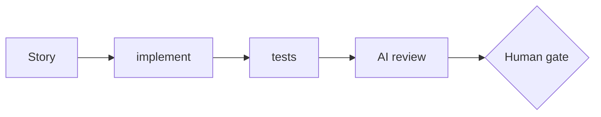

# Gate Review Pack — Story <id>: <title>

**Gate**: Story <id> → <next> | **Date**: <YYYY-MM-DD> | **Decision**: _pending (yes / no)_

## Summary (read aloud)

<Three to five plain sentences: what was built, whether tests and review passed, what changed in
the spec, what needs the human. No tables or symbols — this is spoken by `npm run review:speak`.>

## What was done

| Area | Result | Evidence |
|---|---|---|
| Spec → plan → tasks → implement | <n/n tasks> | `specs/<dir>/` |
| Tests | <pass/fail, type> | `<test file>` |
| Build / deploy | <result> | <URL or command> |
| Hand-written code | 0 lines | Constitution I |

## Estimate vs actual

<!-- Story 9 (retrospective) reads these fields. Keep the row names. -->

| Measure | Estimate (Gate 1) | Actual |
|---|---|---|
| Time | <h> | <h, from git timestamps> |
| Story points | <sp> | <sp> |
| Tokens | <n> | <n, from Claude Code usage> |
| Dollars | <$> | <$, API-equivalent> |
| Test type | — | <e.g. Playwright end-to-end, node:test unit> |

## Diagram

## AI code review — findings and actions

| Severity | Finding | Action |
|---|---|---|
| <🔴/🟡/🔵/❓> | <finding> | <Fixed / Deferred → Story n / Ignored: reason> |

## Notes

- <anything the human must know before deciding>
